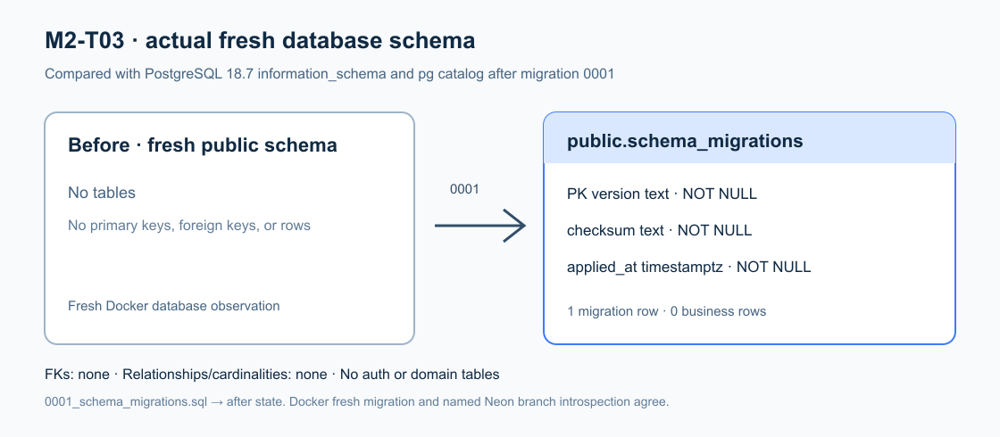

# M2-T03 GO checkpoint — H-M2-03 deployable data shell

- Ticket: [M2-T03](../tickets/m2-authoritative-foundation/M2-T03-data-shell.md), batch 3, state `awaiting_review`.
- Code repository: `https://github.com/adityaa11/bride-assistant.git`; exact code commit `d52067955f833fdf803c96f868cb4b3f67a36218`.
- Accepted dependencies: [M2-T01 CK PASS](../feedback/M2-T01-topology-local-profile-123e6b4-ck.md) and [H-M2-01](../evidence/m2-t01/H-M2-01-topology-v1.md); [M2-T02 CK PASS](../feedback/M2-T02-runtime-lock-ccf351b-ck.md) and [H-M2-02](../evidence/m2-t02/H-M2-02-runtime-v1.md). No predecessor was reopened.
- Current handoff: [H-M2-03 v1.0](../evidence/m2-t03/H-M2-03-data-shell-v1.md), with [executed validation](../evidence/m2-t03/validation.md) and the rendered ERD below.

## Review Contract Closure

| Row and ticket authority | Required proof / pass condition | Evidence locator, exact validation and outcome | Status |
| --- | --- | --- | --- |
| `RC-M2-03A` · T03 acceptance A, EUP-M2-03 | Fresh Docker and production-like Neon target migrate/connect; repeat safe; missing/invalid secret fails without echo. | [Docker log](../evidence/m2-t03/docker.log): `npx --yes node@24.22.3 scripts/m2-data-evidence.mjs` PASS for pre-migration empty DB, first/repeat `0001`, built `next start` route HTTP 200 and invalid URL startup HTTP 500 with redacted `DATABASE_STARTUP_FAILED`; isolated volume removed. [Missing-secret command](../evidence/m2-t03/missing-secret.log): migration exit 1, `DATABASE_URL_MISSING`. [Neon repeat](../evidence/m2-t03/neon-migrate-repeat.log): named-secret `npx --yes node@24.22.3 scripts/m2-migrate.mjs` PASS twice, version `0001`. [Deployment record](../evidence/m2-t03/deployment.json) `READY`; `vercel curl <deployment>/api/system/database` returned `ready`, 18.7, `0001`, Node 24.22.3. | `PROVEN` |
| `RC-M2-03B` · T03 acceptance B, SEC-M2-03 | Production TLS certificate verified, server-only environment, negative connection, no credential in Git/client artifacts. | `shared/server/database.mjs` enforces named target and `sslmode=verify-full`, `rejectUnauthorized: true`. [Neon log](../evidence/m2-t03/neon.log): `npx --yes node@24.22.3 scripts/m2-neon-evidence.mjs` PASS, encrypted/authorized TLS stream; invalid CA rejected with `UNABLE_TO_GET_ISSUER_CERT_LOCALLY`. Post-commit byte scans: zero T01 secrets in 210 tracked and 27 client files, zero ignored OIDC token in 237 tracked/client files. `.env.local` and `.local-storage/` remain ignored and excluded from Vercel upload. | `PROVEN` |
| `RC-M2-03C` · T03 acceptance C, SQL/empty-state scope | Only minimal shell migration; disposable test state and teardown; zero business rows on first use. | [Frozen ticket](../tickets/m2-authoritative-foundation/M2-T03-data-shell.md) authorizes the ledger prerequisite; code `migrations/0001_schema_migrations.sql` creates only that table. [Docker log](../evidence/m2-t03/docker.log) and [Neon log](../evidence/m2-t03/neon.log) show exactly one public table, ledger version `0001`, zero business tables/rows; disposable test schema dropped and Compose volume removed. No fixture seed, conditional migration, auth/domain model or production data import. | `PROVEN` |
| `RC-M2-03D` · T03 acceptance D, EUP-M2-03 | Deployed startup/route and migration command invoke one connection path; publish T04 contract. | `instrumentation.ts` → `shared/server/database.mjs` → Neon; `app/api/system/database/route.ts` uses the same `withDatabase` client; `scripts/m2-migrate.mjs` uses it for the ledger. [Deployment metadata](../evidence/m2-t03/deployment.json) shows live route Node 24.x in `sin1`, [validation](../evidence/m2-t03/validation.md) records remote request and current build. [H-M2-03](../evidence/m2-t03/H-M2-03-data-shell-v1.md) versions environment names, error codes, connection/migration contract and T04/T05/T06 consumers. | `PROVEN` |
| `RC-M2-03E` · T03 ERD and acceptance E; repository AGENTS.md | Render actual before/after SQL schema, keys/relationships and migration mapping; compare fresh migrated DB; display image. | Rendered [PNG](../evidence/m2-t03/actual-erd.png) below and [SVG](../evidence/m2-t03/actual-erd.svg), both committed with this checkpoint. [Validation comparison](../evidence/m2-t03/validation.md) and `docker.log`/`neon.log` match `0001_schema_migrations.sql` to one table, PK `version`, no FK or relationships; fresh Docker before state has zero tables. | `PROVEN` |

Internal readiness: `READY_FOR_CK`. This is GO readiness only; CK alone issues `PASS`.

## Rendered actual ERD

`0001_schema_migrations.sql` is the sole structural migration and maps to the after state. Before: no public table. After: `schema_migrations(version PK, checksum, applied_at)` with one ledger row; zero FKs, relationships/cardinalities, auth/domain tables or business rows. Fresh migrated Docker introspection and current Neon introspection match every field and key shown. The earlier [planning diagram](../evidence/m2-t03/proposed-erd.svg) proposed the same affected schema before implementation.

## Actual Use Path

`EUP-M2-03`: local `npm run check` and Vercel `deploy --prod` of the clean code commit → Next Node runtime `instrumentation.ts:register` → `shared/server/database.mjs:withDatabase/databaseState` → T01 Neon pooled PostgreSQL 18.7, verified TLS and ledger `0001` → `app/api/system/database/route.ts:GET` returns deployed readiness to the authenticated Vercel probe. Separately, operator `scripts/m2-migrate.mjs` uses the same `withDatabase` path to apply/verify `migrations/0001_schema_migrations.sql`. `H-M2-03` is the explicit T04 auth, T05 utilities, and T06 repository handoff. T04's persistent auth consumer is a successor and is not claimed as implemented here. There is no superseded production PostgreSQL path or fallback: T01 had only a preparation profile and fixtures remain review-only.

The remote deployment build succeeded at Node 24.x; its `api/system/database` function is in `sin1` and returned `nodeVersion: v24.22.3`. The first remote upload included the local `.atlas` junction and failed at build; the final committed `.vercelignore` excluded it. The successful `READY` deployment is the only review target. Vercel Authentication remains enabled; the temporary CLI automation bypass used for the probe was removed.

## Migration Inventory

| Version / intended change | Authority and consumer | State and test separation |
| --- | --- | --- |
| `0001_schema_migrations.sql`: create `public.schema_migrations`, `version` PK, `checksum`, `applied_at` | T03 minimal migration ledger prerequisite; T04 adds its own authorized auth schema after this handoff. | Fresh Docker and Neon both show only this table. `scripts/m2-data-evidence.mjs` creates a unique Compose database, creates test data in `m2_t03_disposable_test.fixture`, drops that schema, then removes the Compose volume. No test-only migration or production seed. |

## Actual Empty-State Evidence

A clean Docker 18.7 volume started with zero public tables. The first migration created only the ledger and recorded version `0001`; the repeat made no new row. The built Next server's actual `/api/system/database` endpoint returned HTTP 200 `ready` with version `0001`, without initializing business data. The named Neon branch has that same single table and zero business rows after its first migration. An invalid URL failed the startup check and endpoint without echoing a secret. No hidden default database, domain record, admin identity or auth session was created; T04 owns the first identity handoff.

## Validation, scope and limits

`npm run check` PASS (ESLint, TypeScript, 13/13 Node tests, build) at the bound commit; direct approved Node 24.22.3 ESLint, TypeScript and 13/13 tests PASS. `npx --yes node@24.22.3 node_modules/next/dist/bin/next build` PASS locally, and Vercel remote `npm run build` PASS. Docker integration, Neon TLS/schema probe, Neon repeat migration, deployment metadata/route, post-commit secret scan, and `git diff HEAD --check` PASS as detailed in [validation](../evidence/m2-t03/validation.md). Source worktree clean; no unapproved ORM, schema, authentication behavior, provider, storage path, real data, or deployment Git connection was added. The Vercel project has no Git connection, so future revisions require an explicit deployment. No T04/T05/T06 capability or CK approval is claimed.
