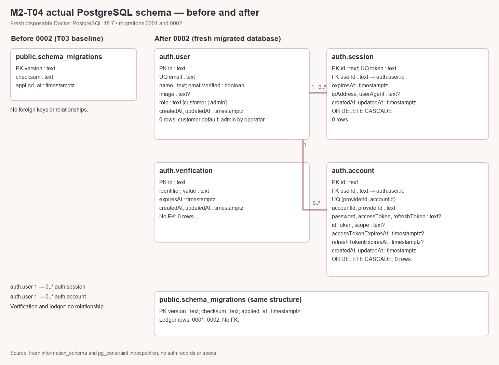

# M2-T04 GO checkpoint — persistent customer and admin authentication

- Ticket: [M2-T04](../tickets/m2-authoritative-foundation/M2-T04-persistent-auth.md), batch 4, state `awaiting_review`.
- Code repository: `https://github.com/adityaa11/bride-assistant.git`; exact implementation commit `af6409c41d06710d7dd14ab027c3af947ae3968f`.
- Accepted predecessor: [M2-T03 CK PASS](../feedback/M2-T03-data-shell-d520679-ck.md) at `d52067955f833fdf803c96f868cb4b3f67a36218`, consuming [H-M2-03](../evidence/m2-t03/H-M2-03-data-shell-v1.md). T01/T02 remain accepted.
- User migration confirmation: after the initial `public` proposal was questioned, a revised rendered ERD placed the four Better Auth tables in `auth` and retained the T03 ledger in `public`. The user explicitly confirmed, “okay, use auth” on 24 November 2026 before `0002` was written or run. No further structural change was made to that proposal.
- Evidence: [local validation and schema comparison](../evidence/m2-t04/validation.md), [H-M2-04 session actor handoff](../evidence/m2-t04/H-M2-04-session-actor-v1.md), and the actual ERD below.

## Actual rendered ERD

The image is a rendered PNG of the fresh disposable database: before `0002`, only the T03 `public.schema_migrations` table; after `0002`, four empty `auth` tables plus the unchanged ledger. It names primary and foreign keys and both 1-to-0..* user relationships. [Fresh introspection](../evidence/m2-t04/schema-after.json) lists every actual column, constraint and index. The migration-to-image comparison and zero-row check are recorded in the [validation record](../evidence/m2-t04/validation.md).

## Review Contract Closure

| Row | Ticket authority and pass condition | Required proof, locator, exact validation and outcome | Status |
| --- | --- | --- | --- |
| `RC-M2-04A` | T04 acceptance A and `EUP-M2-04`: customer registration/sign-in, persistent cookie across process restart, expiry and sign-out denial. | `tests/m2-t04.browser.spec.ts` browser → Next → Better Auth → Docker PostgreSQL flow; Playwright `npx playwright test tests/m2-t04.browser.spec.ts` — 1 PASS. HttpOnly cookie, customer sign-out/sign-in, expired session redirect and direct route status are recorded in [validation](../evidence/m2-t04/validation.md). A separate process was stopped/restarted with the same database and cookie; `/beranda` returned 200 and `get-session` returned the persisted customer session. | `PROVEN` |
| `RC-M2-04B` | T04 acceptance B, `SEC-M2-04`: customer/admin denial, forged role resistance, no admin on empty DB. | Same browser test — 1 PASS: anonymous/customer/admin route requests; `role=admin` cookie and sign-up body rejected as authority; explicit CLI promotion gave admin access; wrong-role denial. Fresh empty `bride_t04_erd` had zero auth rows, `/admin` → `307 /admin/masuk`, unknown sign-in → 401, first customer remained customer. [Validation](../evidence/m2-t04/validation.md) and [schema introspection](../evidence/m2-t04/schema-after.json). | `PROVEN` |
| `RC-M2-04C` | T04 acceptance C and true path: active auth routes have no prototype success or seed credentials; named review fixture routes remain non-authoritative. | `app/(customer)/masuk/page.tsx`, `daftar/page.tsx`, and `app/(admin-auth)/admin/masuk/page.tsx` call `shared/live-auth.tsx`; `app/api/auth/[...all]/route.ts` is the server handler. Named `[state]` routes still use `shared/customer-auth.tsx` and display scenario provenance. Browser test signed out, visited `/masuk/success`, observed fixture label and denial on `/beranda`. `npm run check` — 13/13 Node tests and build PASS; browser test — 1 PASS. | `PROVEN` |
| `RC-M2-04D` | T04 acceptance D, frontend contract and pinned form guidance: reference hierarchy, labels/autofill, focus, error/loading and narrow width. | Fresh [desktop/mobile/error/loading/focus captures](../evidence/m2-t04/validation.md) inspected against committed M1-T08 reference; browser test asserts label/autocomplete, skip-link focus, loading disabled, error alert, and 380px no-overflow — 1 PASS. `npm run check` — lint, TypeScript, 13/13 Node tests and production build PASS. Immutable baseline locator: artifact commit `b69d86157fa2a0d4171cc9e600262e6f5bd25578`, `evidence/M1-T08/reference-daftar-desktop.png` blob `66d6b29049917b138ec13aa5a8a6f7fbcbed53ff` and `evidence/M1-T08/reference-masuk-desktop.png` blob `afb5aff9f6d9a5780e6473e26c5eb5c6155a64c9`; original code commit `4035d713d0b12710b96e120475edaaa5726283b2`, source reference desktop 1280×960. These immutable reference images remain applicable because the reference source and capture settings did not change; all implementation captures are new at the T04 revision. | `PROVEN` |
| `RC-M2-04E` | T04 acceptance E and repository SQL review contract: rendered before/after actual ERD, keys/cardinalities, migration mapping, fresh DB match. | Rendered [actual ERD](../evidence/m2-t04/actual-erd.png) above; [fresh introspection](../evidence/m2-t04/schema-after.json); [comparison](../evidence/m2-t04/validation.md). `0001` unchanged; `0002_better_auth_identity.sql` creates `auth` and four tables; migration runner returned `[0001,0002]` and repeat returned the same. Fresh database before `0002` had only the ledger; after had exactly five tables and zero auth rows. | `PROVEN` |

Internal readiness: `READY_FOR_CK`. This is a GO self-check, not CK `PASS`.

## Actual Use Path

`Browser /daftar, /masuk or /admin/masuk` → `shared/live-auth.tsx` → Better Auth `POST /api/auth/*` handler → `shared/server/auth.ts` → validated `authDatabasePool` in `shared/server/database.mjs` → PostgreSQL `auth.user/account/session` → request headers at `shared/server/actor.ts:sessionActor` → customer `/beranda`, `/booking`, `/booking-saya` layouts or admin layout → workspace or role-appropriate redirect. The committed operator-only `scripts/m2-provision-admin.mjs` is the sole admin promotion entrypoint. Browser and direct HTTP observations are in the validation record. No active production sign-in route calls `shared/customer-auth.tsx`; that component remains reachable only from explicit named fixture review routes and cannot issue a session. No localStorage credential branch or seed credential is reachable.

## Migration Inventory

`0001_schema_migrations.sql` is the unchanged T03 ledger and is mapped to the before state. `0002_better_auth_identity.sql` creates schema `auth`, `auth.user` (server-owned customer/admin role), `auth.session`, `auth.account`, and `auth.verification`, their keys, cascading user references, and indexes; it is mapped to the after state. It writes no identity, admin, fixture or domain seed data. The operational consumer is Better Auth through the `pg` adapter. Browser test identities, explicit promotion and expiry updates existed only in the isolated Docker database. The Compose volume and network were removed; no test-only migration or seed SQL was committed.

## Actual Empty-State Evidence

The separate freshly migrated `bride_t04_erd` database had zero rows in every auth table. The actual `/admin` entrypoint returned `307 /admin/masuk`; an unknown sign-in returned 401. First customer registration succeeded, ignored a forged admin role and still received admin denial. No admin was implicitly initialized. The first handoff is the customer session actor; the admin handoff exists only after operator promotion. These observations precede any fixture or seed and are recorded in the validation record.

## Scope and limitations

The source changes only T04 auth, route guards, sign-in/register UI and their direct tests. Record ownership and input policy remain T05. The reference phone input was removed from live registration because T04 has no phone persistence; accepting an unstored phone number would misrepresent the account. The named fixture route preserves the M1 form reference. Local proof does not assert a new Vercel deployment or changed Neon adapter; T01/T03 provider evidence is the accepted baseline under the local-first ticket rule.
