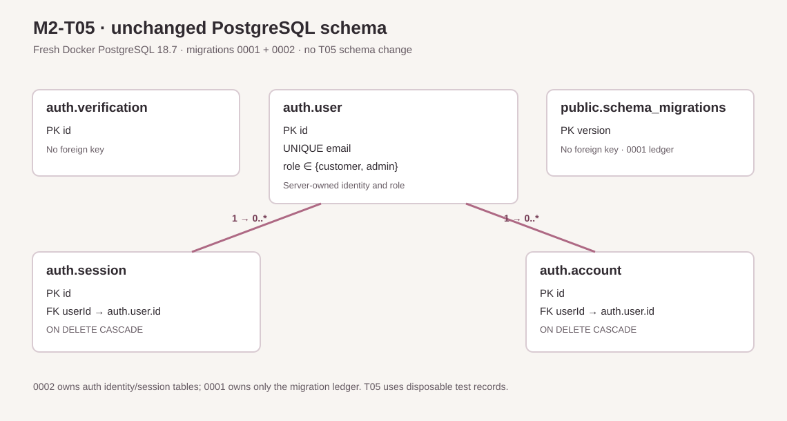

# M2-T05 GO checkpoint — server actor, ownership and input boundary

- Ticket: [M2-T05](../tickets/m2-authoritative-foundation/M2-T05-authorization-validation.md), batch 5; state `awaiting_review`.
- Code repository: `https://github.com/adityaa11/bride-assistant.git`; exact implementation commit `4cac47c1cc4a3b3d0998372d23f4ba4561cc2dc0`.
- Accepted predecessor: [M2-T04 CK PASS](../feedback/M2-T04-persistent-auth-af6409c-ck.md) at `af6409c41d06710d7dd14ab027c3af947ae3968f`; [H-M2-04](../evidence/m2-t04/H-M2-04-session-actor-v1.md) supplies the persisted actor.
- User SQL confirmation: the unchanged-schema preview and definition, purpose and responsibilities of `0001`/`0002` were shown on 24 November 2026. The user explicitly replied, “Confirm unchanged schema and proceed,” before implementation and local migration execution. No production SQL was changed.
- Evidence: [local validation and fresh schema comparison](../evidence/m2-t05/validation.md), [H-M2-05 handoff](../evidence/m2-t05/H-M2-05-authorization-v1.md), and the rendered actual ERD below.

## Actual rendered ERD

This current-state image reflects the fresh disposable database after unchanged `0001` and `0002`. It names all five tables, primary and foreign keys, and user 1 → session/account 0..* cardinalities. The [fresh database comparison](../evidence/m2-t05/validation.md) maps each migration to the diagram and confirms the schema is unchanged by T05.

## Review Contract Closure

| Row | Ticket authority and pass condition | Required proof, evidence locator, exact validation and outcome | Status |
| --- | --- | --- | --- |
| `RC-M2-05A` | Acceptance A: anonymous/customer-on-admin route denial; another customer's authoritative owner ID denies with no data or effect. | `tests/m2-t05.browser.spec.ts` requests actual `/admin` and `/beranda` with T04 sessions and uses a disposable PostgreSQL owner record read from a trusted lookup. Anonymous, wrong-role, forged-cookie and wrong-owner results plus unchanged row counts are in [validation](../evidence/m2-t05/validation.md). `npx playwright test tests/m2-t05.browser.spec.ts tests/m2-t04.browser.spec.ts` — 2/2 PASS. | `PROVEN` |
| `RC-M2-05B` | Acceptance B: matching actor/owner and valid schema produce typed success; malformed input and forged owner/role fail safely. | Same browser integration harness contains valid, invalid and forged identity table against `decideActorInput` with disposable records. It asserts `parsedData`, typed failure codes, safe field list and no write. `npx playwright test tests/m2-t05.browser.spec.ts tests/m2-t04.browser.spec.ts` — 2/2 PASS. | `PROVEN` |
| `RC-M2-05C` | Acceptance C, `H-M2-05` and `EUP-M2-05`: server-only entrypoint, explicit inputs/errors, active protected probe, no copied authority logic or generic registry. | Four protected layout imports call `authorizeRequest` → `sessionActor` → `decideActorInput`; [handoff](../evidence/m2-t05/H-M2-05-authorization-v1.md) records named interface and owner provenance. The T05 route requests and T04 regression reached the active layouts — 2/2 PASS. `npm run lint`, `npm run typecheck`, `npm test` — PASS (13/13 Node tests); `npm run build` — PASS. | `PROVEN` |
| `RC-M2-05D` | Acceptance D: empty owned-record scope returns explicit empty result without a default or other-customer data. | With one other-customer record in a temporary PostgreSQL table, a missing lookup passed `recordOwnerId: null` and returned `record: "missing"`, no private value, and unchanged count; `/booking-saya` request returned 200 under the customer session with no auth row count change. [Validation](../evidence/m2-t05/validation.md). `npx playwright test tests/m2-t05.browser.spec.ts` — 1/1 PASS (combined final run 2/2). | `PROVEN` |

Internal readiness: `READY_FOR_CK`. This is a GO self-check, not CK `PASS`.

## Actual Use Path

`Authenticated GET /admin, /beranda, /booking or /booking-saya` → T04 `sessionActor()` from request headers/persisted Better Auth session → corresponding protected layout → `authorizeRequest({requiredRole, payload: undefined, schema: z.undefined()})` → `decideActorInput` → protected workspace or existing audience redirect. `tests/m2-t05.browser.spec.ts` made direct requests with anonymous and customer sessions; the T04 browser regression also exercised the admin session and denial paths. The four former layout-local role comparisons are removed. There is no UI-state or URL-derived authorization path.

For future record commands and reads, the same decision takes an authoritative `recordOwnerId` obtained by the consumer's lookup, plus an unknown payload and named Zod schema. T05's disposable owner fixture proves this contract; it is intentionally not a production repository path. T06/M3/M4 retain responsibility for their record lookup, domain effects and response mapping.

## Migration Inventory

No intended SQL migration or production-data change. Existing `0001_schema_migrations.sql` owns the migration ledger and existing `0002_better_auth_identity.sql` owns Better Auth identity/session tables; both map to the [unchanged actual ERD](../evidence/m2-t05/actual-erd.svg). The T05 test creates one temporary owner table inside a transaction and rolls it back. Test identities live only in the isolated Docker database, whose volume and network are removed after evidence collection. No seed SQL or migration-runner conditional was added.

## Actual Empty-State Evidence

The local database began freshly migrated with no auth or owner records. Anonymous `/admin` and `/beranda` returned 307 to their sign-in routes. After disposable customer registration, the owner fixture contained only another customer's record; looking up a missing owned record returned `record: "missing"` with no record content and no write. The existing `/booking-saya` route still serves M1 fixture review content after role authorization; it is not a live owned-record read, so the test-scoped contract is the empty-result consumer until T06/M3/M4 activate a domain repository.

## Scope and limitations

The source commit contains the authorization/parse boundary, protected-layout consumption and a disposable integration harness only. It does not introduce domain records, catalogue rules, booking transitions, proof policy, admin delegation or a global permission registry. Local proof does not claim a changed Vercel deployment or Neon provider path; the approved T01/T03 baseline is reused. The user-supplied `AGENTS.md` edit remains outside the source commit.
