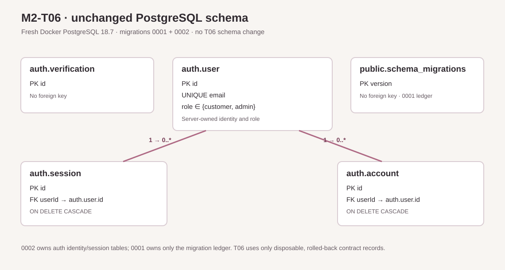

# M2-T06 GO checkpoint — repository and universal DocumentStore contracts

- Ticket: [M2-T06](../tickets/m2-authoritative-foundation/M2-T06-adapter-contracts.md); batch 6; state `awaiting_review`.
- Code repository: `https://github.com/adityaa11/bride-assistant.git`; exact implementation commit `d806c9357a2ffb8404ad4aac0a66821449ce0a7e`.
- Artifact store: configured `C:/Workspace/bride-assistant-artifacts`, origin `https://github.com/adityaa11/bride-assistant-artifacts.git`, `atlas-workflow` layout. Pre-write index empty; only the four existing `.gitkeep` paths were untracked.
- Predecessors T03/T04/T05: CK `PASS` at `d52067955f833fdf803c96f868cb4b3f67a36218`, `af6409c41d06710d7dd14ab027c3af947ae3968f`, and `4cac47c1cc4a3b3d0998372d23f4ba4561cc2dc0`.
- User confirmed the unchanged SQL schema proposal and rendered ERD in this GO conversation before implementation. No new SQL migration or data migration was authorized or created.

## Bounded implementation

`shared/document-store.ts` now exposes one two-operation byte interface for portfolio, testimonials, events, and payment proofs, including JPEG, PNG, WebP, and PDF metadata. Fixture-only removal, orphan cleanup, and record associations remain in its fixture extension. `shared/server/local-document-store.ts` implements the four collection cases with opaque keys, SHA-256, size, type detection, malformed-key absence, and unsupported document rejection. `shared/server/repository-contracts.ts` is a server-only, typed handoff: repositories consume T05's successful actor/schema decision and return typed value or `NOT_FOUND`/`CONFLICT`/`STORAGE_FAILURE`. It has no runtime production caller because T06 is expressly preparation-only; M3/M4 own activation. No provider adapter, business row, public URL, fixture fallback, or second byte store was introduced.

## Review Contract Closure

| Row | Ticket authority and required proof | Evidence, exact command and outcome | Status |
| --- | --- | --- | --- |
| `RC-M2-06A` | Four upload classes through one byte interface; opaque key/hash/size/type; no PostgreSQL bytes or second store; disposable content/proof conformance. | `shared/document-store.ts`, `shared/server/local-document-store.ts`, `scripts/m2-t06-contract.mjs`; `node scripts/m2-t06-contract.mjs` passed four put/read/hash/type/collection cases, invalid type/collection, and unique opaque keys. The source check confirms the content facade calls `documents.put`; PostgreSQL has only 0001/0002 auth/ledger tables. `node scripts/t18-document-contract.mjs` passed the existing three-collection lifecycle contract. | `PROVEN` |
| `RC-M2-06B` | T05 actor and validated data required for protected repositories; allowed, denied, missing-record, and empty cases; typed errors and source inspection. | `shared/server/repository-contracts.ts` uses `AuthorizationResult<T>` successful branch and `server-only`; `scripts/m2-t06-contract.mjs` runs T05 `decideActorInput` against a disposable PostgreSQL temporary table. Anonymous, wrong-role, wrong-owner, and invalid input cause zero repository calls; empty/missing returns `NOT_FOUND`; matching actor writes one owned record. Same command passed. No fixture or storage-key authority import exists in the repository contract. | `PROVEN` |
| `RC-M2-06C` | Preserve M1 fixture UI/read models and proof placeholders, while production seams have no direct fixture fallback; current route and import observations. | `npm test` passed 13/13 fixture contract tests, including portfolio/testimonial/event/public and customer booking read models. `node scripts/m2-t06-contract.mjs` passed live local POST/GET route checks for all three content fixture collections with a fresh temporary store. Source inspection in that harness binds fixture route → local content facade → `DocumentStore`, and finds no fixture import in the new server repository contract. Named future consumers: M3 catalogue/booking; M4-W01/W02/W05/W06. | `PROVEN` |
| `RC-M2-06D` | Empty byte/record absence, disposable DB and byte setup/teardown, unchanged migration graph. | `node scripts/m2-t06-contract.mjs` passed empty read/invalid-key absence before byte initialization, empty temporary record table, and `NOT_FOUND` without a hidden default. It starts a uniquely named Docker Compose PostgreSQL 18.7 volume, applies 0001/0002, rolls back `ON COMMIT DROP` records, removes the Compose volume and temporary byte directory in `finally`, and confirms exactly the two intended migration files. Fresh catalog query matched all five tables, five PKs and two FKs shown below. | `PROVEN` |

Additional validation: `npm run lint` passed; `npm run typecheck` passed; `npm run build` passed; `git diff --check` passed. The first sandbox build attempt was denied Windows junction creation; an approved rerun outside the sandbox passed. The first contract assertion compared `Buffer` and `Uint8Array` prototypes; the corrected byte-value assertion passed on the final run.

Internal readiness: READY_FOR_CK.

## Actual Use Path

`EUP-M2-06` is preparation-only by ticket authority. Current conformance path: T05 `decideActorInput` → successful actor/parsed-data type in `shared/server/repository-contracts.ts` → disposable PostgreSQL repository adapter in `scripts/m2-t06-contract.mjs` → owned temporary record result/absence. Byte path: content fixture route `app/api/fixtures/m1-t15/content-media/route.ts` → `shared/server/local-content-image-store.ts` → `shared/document-store.ts` → `shared/server/local-document-store.ts` → temporary bytes and fixture UI. The proof-class conformance path uses the same `DocumentStore.put/read` on the disposable local adapter. M3/M4 must prove the future authoritative facade → repository/Neon byte adapter → customer/admin/public effect; T06 does not claim that activation. No superseded production path exists at this stage; existing fixture routes remain explicitly non-authoritative.

## Migration Inventory and actual empty state

No intended migration or production-data change. Existing `0001_schema_migrations.sql` owns the migration ledger; existing `0002_better_auth_identity.sql` owns auth identity/session/account/verification. T06 does not alter either. The local Docker harness applies these to a fresh volume and then tears it down. Its temporary contract table uses a transaction and `ON COMMIT DROP`, followed by rollback; there is no seed SQL or migration-runner conditional. A fresh store starts with no files and `read` returns `null`; an empty temporary repository table returns typed `NOT_FOUND` and creates no record. First allowed write affects only its temporary owned row.

## Actual schema ERD and comparison

Fresh migrated Docker catalog result: `auth.account` PK `id`, FK `userId → auth.user.id`; `auth.session` PK `id`, FK `userId → auth.user.id`; `auth.user` PK `id`; `auth.verification` PK `id`; `public.schema_migrations` PK `version`. Each auth user has zero or many sessions and accounts; each session/account belongs to one auth user. The final harness asserted this exact catalog shape after 0001/0002 and before disposable test rows. Neither migration has a T06 change. The diagram is rendered SVG and matches the observed five-table, seven-constraint shape.

## Handoff

[H-M2-06 v1](../evidence/m2-t06/H-M2-06-contract-v1.md) records input/output/error semantics and successor ownership. CK alone determines `PASS`; this checkpoint requests first review.
