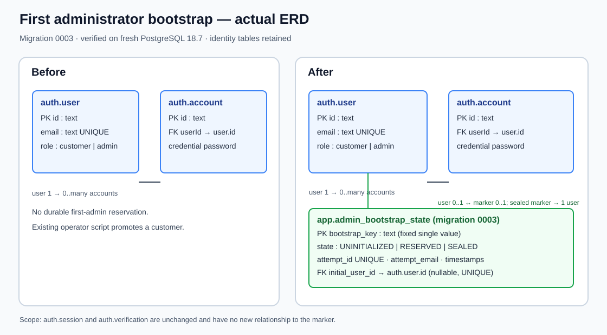

# M2.1-T01 first-admin bootstrap checkpoint binding

- Ticket: [M2.1-T01](../tickets/m2.1-first-admin-bootstrap/M2.1-T01-first-admin-bootstrap.md), state `awaiting_review`; set `BAP-M2.1-SET-01`, batch 1.
- Code repository / exact review commit: `https://github.com/adityaa11/bride-assistant.git` / `fcaae2455308f10f2e46a0092fa097135b56994d`.
- Original implementation record: [admin-bootstrap-fcaae24.md](admin-bootstrap-fcaae24.md). It was committed before this ticket; this binding does not claim a pre-implementation freeze, new code, new migration, or CK approval.
- User authority: explicit confirmation of the displayed 0003 proposal on 25 November 2026, followed by instruction to commit it; subsequent request created M2.1 and this ticket from existing evidence.

## Immutable evidence ledger

All three objects below are retrievable at Atlas artifact commit `4dc1272a6e129f4575c5d30f0d95c341d70ddfca` and originally observe code commit `fcaae2455308f10f2e46a0092fa097135b56994d`:

| Subject and observation context | Artifact path at that commit | Git blob SHA | Applicability |
| --- | --- | --- | --- |
| Rendered actual 0003 before/after schema: PK, FK and cardinalities, checked against fresh disposable PostgreSQL 18.7 migrations 0001–0003 | `evidence/admin-bootstrap/actual-erd.svg` | `14b7cfade9c061e54e1e2b4c48e5b8df4db081ac` | Same exact code commit and migration; CK must visually inspect it with the fresh DB comparison. |
| Local Docker migration/CLI/credential sign-in and production-build browser observations, tests, static checks, teardown and limits | `evidence/admin-bootstrap/validation.md` | `fbb81576416f8ce306282ecaccbe6dfc616a1d70` | Same exact code commit and named local environment. Results do not prove production deployment. |
| Original implementation handoff, confirmation and embedded ERD | `checkpoints/admin-bootstrap-fcaae24.md` | `7a4fe12af6e69147b45dd37b5600b9e8b8c050ec` | Historic checkpoint remains intact; this addendum only supplies ticket identity and a review contract. |

## Review handoff

The committed operational path is documented in [the ticket](../tickets/m2.1-first-admin-bootstrap/M2.1-T01-first-admin-bootstrap.md) and [operator guide](https://github.com/adityaa11/bride-assistant/blob/fcaae2455308f10f2e46a0092fa097135b56994d/docs/admin-bootstrap.md). Existing validation records first bootstrap, sealed rejection, and `/admin/masuk` sign-in. The ticket also asks CK to assess interrupted-attempt reconciliation and its negative boundaries; absent proof should be reported against that row rather than silently marked PASS. CK reviews only this bounded ticket and exact code commit and writes its independent result under `feedback/`. No CK result is asserted here.
