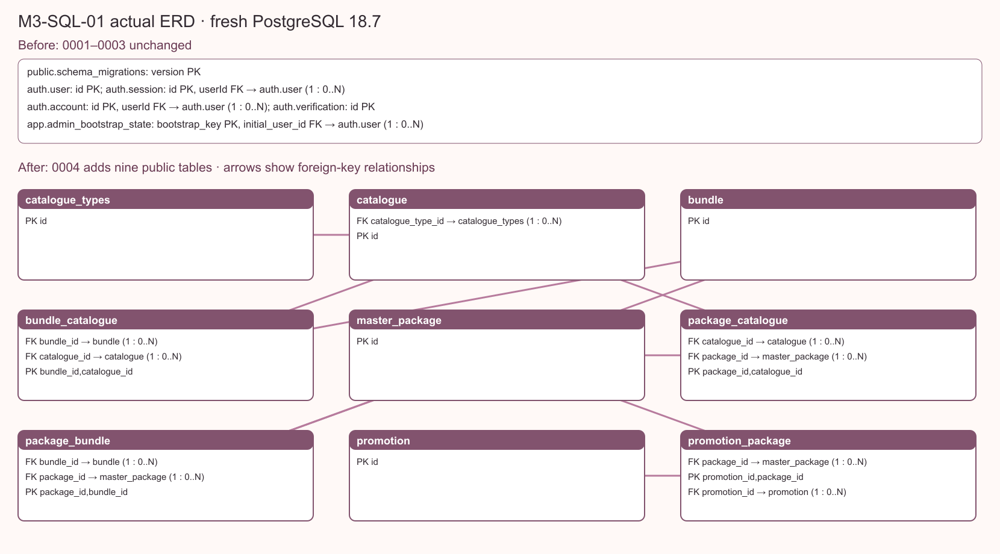

# M3-T01 GO checkpoint — catalogue and package persistence

- Ticket: [M3-T01](../tickets/m3-booking-core/M3-T01-services-actions-model.md); batch 1; state `awaiting_review`.
- Code repository: `https://github.com/adityaa11/bride-assistant.git`; exact code commit: `d164a7d4363e8cbe047921706cb0cd354195626d`.
- User SQL confirmation: on 26 November 2026, after the revised M3-SQL-01 rendered preview and definition/purpose/responsibility explanation were shown, the user replied **“i confirm”**. This preceded writing/running `0004`. The confirmation applies only to M3-SQL-01.
- Result: implementation submitted for CK; this is not a self-issued PASS.

## Implemented scope and handoff

[`0004_catalogue_packages_promotions.sql`](https://github.com/adityaa11/bride-assistant/blob/d164a7d4363e8cbe047921706cb0cd354195626d/migrations/0004_catalogue_packages_promotions.sql) creates the nine proposed catalogue, bundle, package and promotion tables and inserts exactly two system-owned types. PostgreSQL FKs, composite membership PKs and CHECKs enforce type references, nonempty names, positive duration, nonnegative price, valid discount types and values, and date order. `shared/server/catalogue-repository.mjs` and its declaration expose operation-specific typed reads/writes, unique package item expansion and Jakarta-date promotion eligibility. All SQL values are parameters. Create operations return generated UUIDs; they do not provide an idempotency key or silently retry. T02 owns command-level retry/overlap validation and admin route composition; T03 owns public route composition; T04 consumes stable IDs. No fixture fallback or production route was added.

## Review Contract Closure

| Row | Ticket authority and pass condition | Required proof / evidence locator | Exact validation and outcome | Status |
| --- | --- | --- | --- | --- |
| `RC-M3-T01A` | AC-A: one typed catalogue, valid bundle/package relationships, unique expansion, invalid type/FK/price rejection | Fresh migrated DB introspection in [schema JSON](../evidence/m3-t01/schema.json); `scripts/m3-t01-contract.mjs` asserts two type rows, required PK/FKs, Service/Action filters, unique two-item expansion, invalid type/reference/duplicate membership, independent negative price/duration | `node scripts/m3-t01-contract.mjs .local-storage/m3-t01-evidence` — PASS on disposable PostgreSQL 18.7 | `PROVEN` |
| `RC-M3-T01B` | AC-B: promotion fields and package links, inclusive dates, draft/inactive exclusion, unchanged base price | Same script creates percentage and rupiah offers, verifies package joins, Jakarta start/end boundaries, invalid percentage/date order, draft/inactive exclusion and `1000000.00` unchanged base price | Same fresh Docker command — PASS | `PROVEN` |
| `RC-M3-T01C` | AC-C: confirmed migration, actual ERD and fresh/empty database agree with proposal | User confirmation above; [rendered actual ERD](../evidence/m3-t01/actual-erd.png) and [SVG](../evidence/m3-t01/actual-erd.svg); [schema JSON](../evidence/m3-t01/schema.json). Script asserts nine table PKs and nine FKs; fresh migrated ledger is `0001`–`0004`, two types and zero other catalogue rows. Compared with [proposed ERD](../tickets/m3-booking-core/proposed-erd.svg): SQL-01 table/PK/FK/cardinality map matches; auth and ledger baseline unchanged. | Same fresh Docker command — PASS; `npm run lint` — PASS; `npm run typecheck` — PASS; `npm test` — 15/15 PASS; `npm run build` — PASS; `git diff --cached --check` — PASS | `PROVEN` |

Internal readiness: `READY_FOR_CK`.

## Actual Use Path

`EUP-M3-T01` is preparation-only. Current executed path: `scripts/m3-t01-contract.mjs` → operation-specific functions in `shared/server/catalogue-repository.mjs` → parameterized PostgreSQL statements → freshly migrated Docker tables → asserted IDs, rows, item expansion, promotion and empty results. The repository accepts a successful M2-T05-shaped authorization decision and returns the M2-T06 result shape. No production T02/T03 caller exists yet under this ticket's activation boundary; the named successor tickets own `server route → T05 authorization/validation → repository → admin/public effect`. The M1 review fixture routes remain isolated and non-authoritative; no production fallback was added.

## Migration Inventory

Intended migration: `0004_catalogue_packages_promotions.sql` (M3-SQL-01) owns the nine public tables and only `(1, service, Service)` and `(2, action, Action)` production reference rows. `0001` ledger, `0002` auth identity and `0003` admin bootstrap remain unchanged. No booking table, sample package/promotion, test seed, runner branch or production data import was added. The validation script creates a uniquely named disposable Docker Compose project, applies `0001`–`0004`, creates only test records there, and removes its volume in `finally`.

## Actual Empty-State Evidence

Immediately after a fresh migrate, `catalogue_types` returned the two system-owned rows; `catalogue`, `bundle`, `bundle_catalogue`, `master_package`, `package_catalogue`, `package_bundle`, `promotion` and `promotion_package` each counted zero. Catalogue, bundle, promotion and published-package repository reads returned `[]`; a missing package ID returned `NOT_FOUND`. The first admin-shaped create returned a UUID. Only the explicitly published/active package appeared in the published-package read; a draft package did not. The first item, bundle, package and promotion records were disposable transaction-test data, not migration seeds.

## Limits

This is local database and repository proof. No Vercel or Neon path changed, and no remote provider behavior is claimed. T02 owns concurrent same-package promotion-overlap rejection and route activation. T03 owns published public presentation. The existing `AGENTS.md` worktree change was left unstaged and uncommitted.

