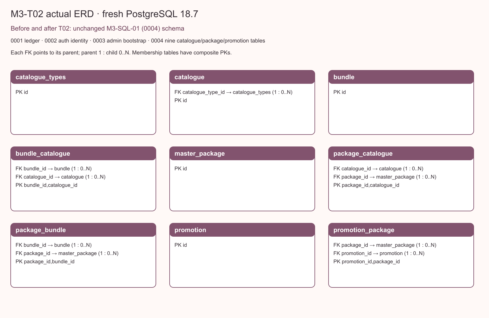

# M3-T02 GO checkpoint — admin catalogue commands

- Ticket: [M3-T02](../tickets/m3-booking-core/M3-T02-admin-services-actions-commands.md); batch 2; state `awaiting_review`.
- Code repository: `https://github.com/adityaa11/bride-assistant.git`; exact code commit: `648874441f4b088bd2c8599e66d5df6f35fcf120`.
- Approved predecessor: M3-T01 CK `PASS` at `d164a7d4363e8cbe047921706cb0cd354195626d`; M2-T05 and M2.1-T01 accepted auth/admin handoffs. The user's 26 November 2026 explicit M3-SQL-01 confirmation is recorded in the T01 checkpoint. No SQL proposal changed here.
- Result: implementation submitted for CK. This checkpoint is not a self-issued `PASS`.

## Implemented scope and handoff

The three production admin routes now load PostgreSQL state after the admin layout's session gate. The client editors submit to `adminCatalogueCommand`, which calls `authorizeRequest` with the admin role and strict Zod values before opening a database connection. `executeAdminCatalogueCommand` creates, updates, publishes through validated fields, and retires Service/Action, Bundle, Master Package and Promotion rows. It returns typed success, conflict, missing or storage results. The Service/Action type selector reads the two durable `catalogue_types` rows and persists the selected FK. The existing named `/[state]` review routes remain non-authoritative fixtures.

Create requests carry one editor UUID request key. The command derives a stable UUID from actor, entity and key; an exact repeat returns the existing row, while a changed payload under the same key conflicts. Updates and retirement address stable IDs. Promotion create/edit locks the union of old and new package rows in sorted ID order, checks inclusive overlap inside the same transaction, then writes promotion and membership rows or rolls back. No command queries or updates a booking snapshot. `H-M3-02` gives T03/T05 durable stable catalogue/package IDs, type IDs, dates, publication flags, updated times and package links; promotion writes do not alter package `base_price`.

## Review Contract Closure

| Row | Ticket authority / required proof | Evidence locator and observed result | Exact command and outcome | Status |
| --- | --- | --- | --- | --- |
| `RC-M3-T02A` | AC-A: admin only, valid type FK and input before writes; real protected route with admin, customer and anonymous | `tests/m3-t02.browser.spec.ts` signs in through committed first-admin bootstrap, creates through `/admin/catalogue`, reloads durable item, and checks anonymous and signed-in customer redirect. `scripts/m3-t02-contract.mjs` checks the two selector rows, customer repository denial, unknown type ID with zero writes, plus create/update/retire/publish for all four entities. `shared/server/admin-catalogue-actions.ts` enforces admin and strict Zod before `withDatabase`. [Current catalogue desktop/mobile](../evidence/m3-t02/catalogue-desktop.png). | `node scripts/m3-t02-contract.mjs .local-storage/m3-t02-evidence` — PASS; `node scripts/m3-t02-browser.mjs` — 1/1 PASS | `PROVEN` |
| `RC-M3-T02B` | AC-B: only future selections change; promotion leaves base price and booking snapshots untouched | The PostgreSQL check records `master_package.base_price = 1000000.00` before/after promotion create/edit/conflict; source call path is restricted to the nine `0004` catalogue/package/promotion tables. No booking table exists yet in the T02 schema and no command-side booking caller or write appears. Package edit/publish and promotion eligibility stay on durable future-selection rows. [Schema inspection](../evidence/m3-t02/schema.json). | Same disposable PostgreSQL command — PASS; `rg -n 'booking|UPDATE public.master_package' shared/server/admin-catalogue-commands.mjs` and direct source inspection — no booking write path | `PROVEN` |
| `RC-M3-T02C` | AC-C: live UI empty/loading/error/success, reload, responsive shell, focus; no fixture fallback | Browser exercised first empty state, saved item/bundle/package/promotion, reload, conflict error and editor focus. [Catalogue desktop](../evidence/m3-t02/catalogue-desktop.png) / [mobile](../evidence/m3-t02/catalogue-mobile.png), [packages desktop](../evidence/m3-t02/packages-desktop.png) / [mobile](../evidence/m3-t02/packages-mobile.png), [promotions desktop](../evidence/m3-t02/promotions-desktop.png) / [mobile](../evidence/m3-t02/promotions-mobile.png), [promotion error](../evidence/m3-t02/promotions-error.png). Current captures were visually inspected: shared admin frame, title, summary/search/type filter and responsive cards retain the M1 hierarchy. Production page sources import only the durable loader/live workspace. | `node scripts/m3-t02-browser.mjs` — 1/1 PASS; `npm run lint` — PASS; `npm run typecheck` — PASS; `npm test` — 15/15 PASS; `npm run build` — PASS | `PROVEN` |
| `RC-M3-T02D` | AC-D: inclusive same-package overlap, adjacent/different-package success, membership edit and concurrent create, no partial write | Disposable PostgreSQL check rejects inclusive end/start overlap, accepts next-day and other-package ranges, rejects edit and new package membership overlap, observes unchanged link count, and races two clients: one create succeeds and one conflicts. Stable package-row `FOR UPDATE` ordering is in `shared/server/admin-catalogue-commands.mjs`; `promotion` count remains four after the race. Browser shows conflict feedback with no record on reload. | `node scripts/m3-t02-contract.mjs .local-storage/m3-t02-evidence` — PASS; `node scripts/m3-t02-browser.mjs` — 1/1 PASS | `PROVEN` |

Internal readiness: `READY_FOR_CK`.

## Actual Use Path

`EUP-M3-T02`: `app/(admin)/admin/layout.tsx` session gate → `/admin/catalogue`, `/admin/packages`, `/admin/promotions` server pages → `loadAdminCatalogue` / `readAdminCatalogue` → PostgreSQL rows → `AdminCatalogueLive` cards and editors → `adminCatalogueCommand` → `authorizeRequest({requiredRole:'admin', schema})` → `executeAdminCatalogueCommand` transaction → durable row/result → revalidated admin page and success/conflict message. The browser test executes this path through bootstrap sign-in, three creates and reload. Source locations are the three committed page files, `shared/server/admin-catalogue-loader.ts`, `shared/admin-catalogue-live.tsx`, `shared/server/admin-catalogue-actions.ts` and `shared/server/admin-catalogue-commands.mjs`. There is no production import of `getScenario`, old catalogue workspace or old promotion workspace from these live routes; their named review routes remain fixture-only.

## Migration Inventory and actual ERD

No intended SQL or production-data migration was added in T02. `0004_catalogue_packages_promotions.sql` is the confirmed M3-SQL-01 schema and two system-owned type rows; `0001`–`0003` remain unchanged. The fresh disposable PostgreSQL 18.7 run applied `0001`–`0004` and introspected nine affected table PKs and nine FKs. [Rendered actual ERD](../evidence/m3-t02/actual-erd.png), [SVG](../evidence/m3-t02/actual-erd.svg) and [schema JSON](../evidence/m3-t02/schema.json) agree with the [confirmed proposal](../tickets/m3-booking-core/proposed-erd.svg) for SQL-01. Before/after T02 is the same schema; T02 only changes command code and disposable test rows. The ERD names each affected table, primary and foreign key, and parent `1 : child 0..N` cardinality. The `0004` file is at code commit `648874441f4b088bd2c8599e66d5df6f35fcf120` and is unchanged from approved T01. Each test run creates a unique local Docker Compose project, migrates, uses disposable rows, and removes the volume in `finally`. No test SQL, seed, or migration-runner branch was committed.

## Actual Empty-State Evidence

At the fresh database, `catalogue_types` returned exactly Service and Action; item, bundle, package and promotion reads returned `[]`. The browser displayed an honest empty state and create action on all three live routes. First create appeared immediately and after reload. A missing bundle edit returned `NOT_FOUND`; an unknown type ID returned `CONFLICT` and left the item count zero. The first created data was discarded with the Docker volume.

## Prior visual baseline reference and limits

The M1 catalogue comparison baseline is artifact commit `f7924cc2a62e75b91e4d14de2a701e88f7ffea89`, path `evidence/M1-T13/implementation-catalogue-1440.png`, blob `60c94054b1ec8cee8cce6362045761f7239a6aff`, observed at code commit `b9fd31e3bd42f2a902dd6201445f471f677ac615`, 1440px desktop. It is a design/hierarchy baseline, not proof of current behavior; the current 1280px desktop and 390px mobile captures and browser execution above provide current-state proof. No Vercel/Neon path changed or remote provider behavior is claimed. The existing user `AGENTS.md` edit was not staged or committed.

