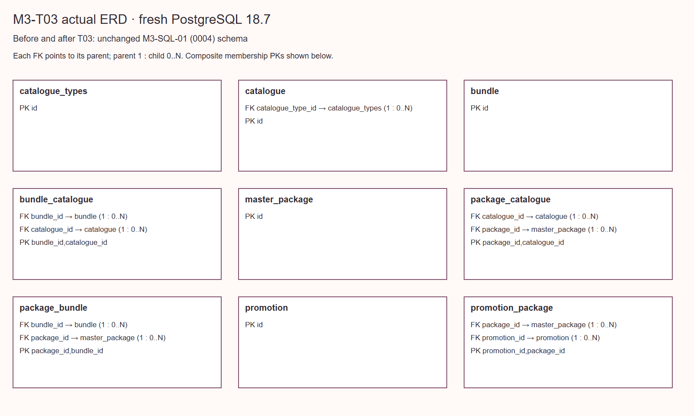

# M3-T03 GO checkpoint — published package reads

- Ticket: [M3-T03](../tickets/m3-booking-core/M3-T03-public-package-reads.md); batch 2; state `awaiting_review`.
- Code repository: `https://github.com/adityaa11/bride-assistant.git`; exact code commit: `ae60f3525fd156734ef5954439a5ba28f9569f69`.
- Predecessor: M3-T01 CK `PASS` at `d164a7d4363e8cbe047921706cb0cd354195626d`. The user confirmed M3-SQL-01 on 26 November 2026 before `0004` was written or run. T03 changes no migration or production data.
- Result: implementation submitted for CK; this checkpoint does not issue `PASS`.

## Implemented scope and handoff

`GET /api/public/packages`, `/`, and authenticated `/booking` now use `loadPublicPackages` and T01's repository expansion/eligibility rule. The projection selects only published and active packages, unique direct/bundled Service/Action items, and at most one published, active, package-linked offer whose inclusive date window contains the trusted server time converted to Asia/Jakarta. The public payload contains display fields only; it omits publication flags, admin command state, and other packages' offers. Base price and offer are separate. Public package links contain only `packageId`; `/booking` validates that UUID and selects it only if it remains published. No booking write, client price authority, fixture fallback, or provider path was added.

H-M3-03 schema/type: `PublicPackageDetail` in `shared/server/public-package-read.ts` has `id`, `name`, `description`, `durationMinutes`, `basePrice`, expanded `items[] {id,name,type}` and nullable `offer {id,title,description,type,value,startsOn,endsOn}`. The source identity is `master_package.id`; package composition comes from T01's `resolvePackageData`. Empty list means no selectable package. Reads are side-effect free; reload reevaluates current DB state, with no retry key or idempotent write. M3-T05 consumes the UUID and must recompute package and promotion from its own trusted booking timestamp; neither displayed price nor offer is an input to submission.

## Review Contract Closure

| Row | Ticket authority and pass condition | Required proof / evidence locator | Exact validation and outcome | Status |
| --- | --- | --- | --- | --- |
| `RC-M3-T03A` | AC-A: published/active package and eligible package-specific promotion only; no draft/admin leak | `scripts/m3-t03-contract.mjs` creates draft, inactive, expired, wrong-package, and valid rows in fresh Docker DB; compares DB result, `GET /api/public/packages` fields, and rendered `/` HTML. [Schema observation](../evidence/m3-t03/schema.json). | `node scripts/m3-t03-contract.mjs .local-storage/m3-t03-evidence` — PASS; migrations `0001`–`0004`, all named visibility cases and negative payload inspection. | `PROVEN` |
| `RC-M3-T03B` | AC-B: displayed base price and unique composition match authoritative read; separate offer; only package ID passes to selection; zero published rows cannot book | Contract script compares `readPublicPackages` to T01 `resolvePackage`, unchanged `1000000.00` base price, public HTML and API, then unpublishes and reloads to observe empty DB/API/route. Browser checks selected UUID route and reload in [public desktop](../evidence/m3-t03/public-desktop.png), [customer desktop](../evidence/m3-t03/customer-desktop.png), and [empty customer](../evidence/m3-t03/customer-empty.png). | `node scripts/m3-t03-contract.mjs .local-storage/m3-t03-evidence` — PASS; `node scripts/m3-t03-browser.mjs .local-storage/m3-t03-browser` — PASS, 1/1 Playwright. | `PROVEN` |
| `RC-M3-T03C` | AC-C: changed discovery/selection preserve hierarchy, responsive behavior, keyboard focus, empty/error states | Current [public desktop](../evidence/m3-t03/public-desktop.png), [public mobile](../evidence/m3-t03/public-mobile.png), [customer desktop](../evidence/m3-t03/customer-desktop.png), [customer mobile](../evidence/m3-t03/customer-mobile.png), [public empty](../evidence/m3-t03/public-empty.png), [public error](../evidence/m3-t03/public-error.png), [customer empty](../evidence/m3-t03/customer-empty.png). Playwright checks focus, selection, reload, no horizontal overflow at 390px; visual inspection found and corrected overwide sparse customer card before final capture. Unchanged customer frame baseline: artifact commit `5ddb74059ed2c7d99b72bfd27cf4f7a38f31f48a`, path `evidence/M1-T10/implementation-booking-desktop.png`, blob `f78a410ec08c4edf8de346bcd8a67d117c68c955`, original code `505f393038ac2b391070aaee2a2d7652667aee48`, desktop fixture shell; its visual frame remains the same while T03 replaces only selection content. Public shell authority is `docs/frontend/M1-T04_PUBLIC_REFERENCE_CONTRACT.md`; current captures prove its unchanged chrome. | `node scripts/m3-t03-browser.mjs .local-storage/m3-t03-browser` — PASS; `npm run lint` — PASS; `npm run typecheck` — PASS; `npm test` — 15/15 PASS; `npm run build` — PASS. | `PROVEN` |

Internal readiness: `READY_FOR_CK`.

## Actual Use Path

`EUP-M3-T03`: anonymous `/` or `GET /api/public/packages`, and signed-in customer `/booking?packageId=<uuid>` → `loadPublicPackages` → `readPublicPackages` → T01 `resolvePackageData` → PostgreSQL `master_package`, membership, catalogue and promotion tables → typed `PublicPackageDetail` → public package cards/API or customer selection. The package link's only serialized selection fact is `packageId`; the customer page validates it and checks the current published list. `tests/m3-t03.browser.spec.ts` executes the public and signed-in customer route, reload and empty paths. Production `/booking` no longer calls `CustomerBooking` or a scenario package source; named `/booking/[state]` review routes remain M1 fixtures. The public route supplies live package/offer props to the established editorial shell; named public fixture routes retain their scenarios.

## Migration Inventory and actual ERD

No intended SQL migration or production-data change in T03. Existing [0004 migration](https://github.com/adityaa11/bride-assistant/blob/ae60f3525fd156734ef5954439a5ba28f9569f69/migrations/0004_catalogue_packages_promotions.sql) is the confirmed M3-SQL-01 consumer dependency. Fresh Docker migration applied `0001`–`0004`; introspection recorded nine affected table PKs and nine FKs in [schema JSON](../evidence/m3-t03/schema.json). The [rendered actual ERD](../evidence/m3-t03/actual-erd.png) and [SVG](../evidence/m3-t03/actual-erd.svg) show the unchanged before/after table names, PKs, FKs and `1 : 0..N` cardinalities. Compared with the confirmed M3-SQL-01 proposed ERD and T01 actual ERD: no structural difference. This ticket's test records were inserted only into uniquely named disposable Docker databases; both harnesses removed the containers and volumes in `finally`. There is no test seed migration or migration-runner branch.

## Actual Empty-State Evidence

With only the two production `catalogue_types` rows and zero package/promotion rows after fresh migration, `readPublicPackages` returned `[]`. After the sole published package was unpublished, `GET /api/public/packages` returned `{packages:[]}`, `/` rendered “Belum ada paket yang dipublikasikan,” and the signed-in `/booking` route rendered “Booking belum dapat dimulai” with no selection link. Reload reflected the changed DB state. No durable seed or default package was used.

## Validation and limits

- `node scripts/m3-t03-contract.mjs .local-storage/m3-t03-evidence` — PASS, fresh disposable Docker PostgreSQL 18.7, schema/ERD comparison, DB/API/HTML negative cases, composition, price, reload, cleanup.
- `node scripts/m3-t03-browser.mjs .local-storage/m3-t03-browser` — PASS, production `next start` against fresh Docker, 1/1 browser case, desktop/mobile/focus/empty/error captures and cleanup.
- `npm run lint` — PASS; `npm run typecheck` — PASS; `npm test` — 15/15 PASS; `npm run build` — PASS; `git diff --cached --check` — PASS.
- No Vercel or Neon probe: provider paths are unchanged and no T03 acceptance row requires provider-specific behavior. This checkpoint makes no remote deployment claim. T05 owns durable booking submission; T03 supplies read and selection handoff only. The pre-existing user `AGENTS.md` worktree modification remains unstaged.

