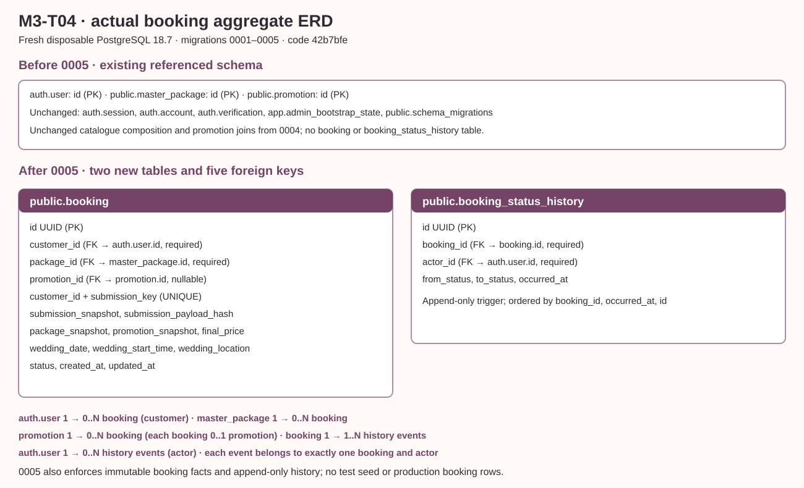

# M3-T04 GO checkpoint — booking aggregate and immutable history

- Ticket: [M3-T04](../tickets/m3-booking-core/M3-T04-booking-model.md); batch 2; state `awaiting_review`.
- Code repository: `https://github.com/adityaa11/bride-assistant.git`; exact code commit: `42b7bfe282399e434c47453133785e62c2be6bad`.
- SQL confirmation: On 26 November 2026 the revised [rendered M3-SQL-04 proposal](../tickets/m3-booking-core/proposed-erd.svg) and [definition, purpose and responsibilities](../tickets/m3-booking-core/migration-proposal.md) were shown to the user. The user replied **“i confirm”** before `0005` was written or run. This confirms SQL-04 only; it does not confirm SQL-07.
- Predecessors: M3-T01 CK `PASS` at `d164a7d4363e8cbe047921706cb0cd354195626d`; M2-T05 and M2-T06 accepted handoffs. T02/T03 are also approved but are not required predecessors for this ticket. No provider path changed, so no Neon/Vercel probe was required.

## Review Contract Closure

| Row | Ticket authority and pass condition | Required proof and evidence locator | Exact validation and outcome | Status |
| --- | --- | --- | --- | --- |
| `RC-M3-T04A` | AC-A: one durable booking ID with copied package base-price/composition, applied promotion or null, actual final price, unchanged snapshots after catalogue edits | Fresh Docker [observations](../evidence/m3-t04/observations.json), `scripts/m3-t04-contract.mjs`: promoted booking base `1000000.00`, final `900000.00`; unpromoted booking final `2000000.00`; package/item/promotion edits leave stored original terms and IDs intact | `node scripts/m3-t04-contract.mjs .local-storage/m3-t04-evidence` — PASS | `PROVEN` |
| `RC-M3-T04B` | AC-B: canonical initial status, ordered append-only history and atomic rollback | Same script: initial `Menunggu Konfirmasi` event with null previous status and customer actor; injected event-insert failure rolls back booking; later events read in time order; SQL update/delete history and booking fact changes fail `23514` | Same fresh Docker command — PASS, four bookings and four initial events before ordering probe | `PROVEN` |
| `RC-M3-T04C` | AC-C: empty/missing behavior and actual confirmed schema, no test seed | Empty own-list `[]`, missing/other-owner detail `NOT_FOUND`; fresh migration ledger `0001`–`0005`; [rendered actual ERD](../evidence/m3-t04/actual-erd.svg) and [catalog constraints](../evidence/m3-t04/observations.json) show two new PKs, five FKs, scoped unique key and checks. Test data and Compose volume removed in `finally`. | Same fresh Docker command — PASS; `npm run lint` — PASS; `npm run typecheck` — PASS; `npm test` — 15/15 PASS; `npm run build` — PASS; `git diff --cached --check` — PASS | `PROVEN` |
| `RC-M3-T04D` | AC-D: one customer/key/initial event on identical sequential or concurrent replay, changed-payload conflict, cross-customer isolation, replay after later wedding date/location edit | Same script and observations: repeated ID, one initial event, changed note `CONFLICT`, same key independently creates customer-2 booking, parallel same-key calls return one ID, replay after current date/location update returns original ID. Unique constraint and immutable submitted snapshot/hash inspected. | Same fresh Docker command — PASS | `PROVEN` |

Internal readiness: `READY_FOR_CK`. This is an implementation readiness statement, not a CK `PASS`.

## Actual Use Path

`EUP-M3-T04` is preparation-only. The executed integration caller `scripts/m3-t04-contract.mjs` supplies an M2-T05-shaped successful customer actor/validated payload → `createBooking`, `listOwnBookings`, `readOwnBooking` in `shared/server/booking-repository.mjs` → transactional parameterized statements and `resolvePackage` in `shared/server/catalogue-repository.mjs` → fresh PostgreSQL `booking`/`booking_status_history` rows → observed ID, snapshot, history, retry and absence results. The code verifies the actor's trusted subject ID and scopes reads to that ID. T05 owns actual server authorization, route composition and customer UI consumption; T06 owns admin transitions. No production route is claimed in T04. The existing M1 booking fixture routes remain declared review fixtures, not a fallback for this repository. No superseded production booking path was activated or retained by this ticket.

H-M3-04 type and identity: `booking.id` UUID; `customer_id` FK from trusted actor; `package_id` and optional `promotion_id` stable catalogue FKs; required `(customer_id, submission_key)` unique retry identity; complete immutable `submission_snapshot` and SHA-256 canonical payload hash; current wedding date/location and immutable start time; immutable package name, description, duration, base price, composition and promotion terms; `final_price`; canonical initial status; ordered history with actor/time. `createBooking` returns the original booking on same hash/key or `CONFLICT` on changed payload. `listOwnBookings` and `readOwnBooking` supply customer-scoped reads. T05/T06 must validate their inputs and compose the actual routes.

## Migration Inventory

Intended [0005_booking_aggregate.sql](https://github.com/adityaa11/bride-assistant/blob/42b7bfe282399e434c47453133785e62c2be6bad/migrations/0005_booking_aggregate.sql) implements confirmed M3-SQL-04: two booking tables, five FKs to customer/package/promotion/booking/actor, customer-scoped submission uniqueness, snapshot and price checks, immutable booking-facts trigger, and append-only history trigger. It owns no production rows. Existing `0001` ledger, `0002` auth, `0003` bootstrap and [0004 catalogue](https://github.com/adityaa11/bride-assistant/blob/42b7bfe282399e434c47453133785e62c2be6bad/migrations/0004_catalogue_packages_promotions.sql) are unchanged. The SVG shows before and after, named PKs/FKs and relationship cardinalities. Fresh PostgreSQL 18.7 introspection in the observations file matched the two new PKs, five FKs and `(customer_id, submission_key)` unique constraint; the script also exercised both triggers. The after-state matches the confirmed SQL-04 proposal. No SQL-07 reservation table was created. Forward-only migration runner applies `0005` transactionally and records its checksum; there is no destructive rollback script. Every test record is created only in a uniquely named local Docker Compose database, and `down --volumes` removes it. No test seed or migration-runner branch was added.

## Actual Empty-State Evidence

Immediately after fresh `0001`–`0005`, before disposable customer/package inserts, `listOwnBookings` returned `[]` and `readOwnBooking` for a missing UUID returned `NOT_FOUND`. No booking or history row was initialized. The first valid submission created exactly one booking and its initial event in one transaction; an injected history-insert failure left both tables at zero before that first successful create. No hidden default booking, package or promotion was used.

## Limits

The contract script exercises the repository against real disposable PostgreSQL, not a production T05/T06 route; those successor tickets own route and UI proof. Local tests make no claim about a changed production deployment. The pre-existing uncommitted `AGENTS.md` change in the code worktree was preserved and excluded from the source commit.
