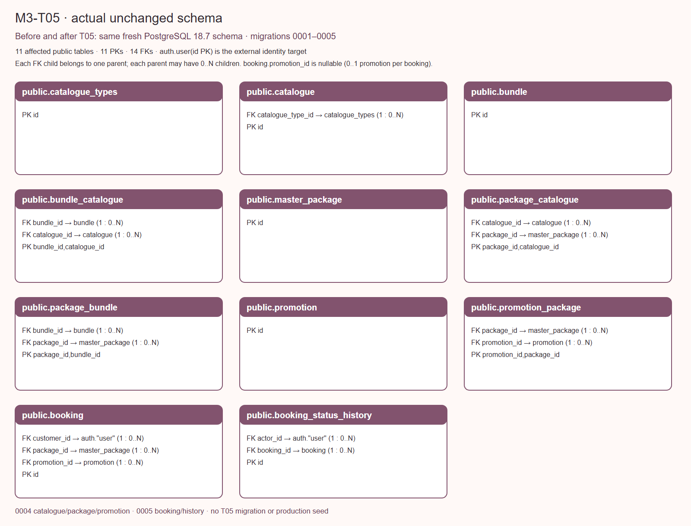

# M3-T05 GO checkpoint — prepared customer booking and own read

- Ticket: [M3-T05](../tickets/m3-booking-core/M3-T05-customer-booking-flow.md); batch 3; state `awaiting_review`.
- Code repository: `https://github.com/adityaa11/bride-assistant.git`; exact code commit: `378248c1945f3f75b5b1d67f6545d0358f57fee7`.
- Predecessors: M3-T02 CK `PASS` at `5902338`, M3-T03 CK `PASS` at `25782a2`, M3-T04 CK `PASS` at `42b7bfe`, and accepted M2-T05 actor/input handoff. T04's booking repository and T03's published package selection were consumed without reopening their approved scope.
- SQL confirmation: On 26 November 2026, the user was shown the unchanged-schema rendered catalogue and booking ERDs plus the definitions, purposes and responsibilities of migrations `0001`–`0005` for T05, then explicitly replied **“i confirm”**. No migration file or production seed changed. This confirmation is T05-specific and does not confirm SQL-07.
- Artifact store: tracked `atlas-workflow.yaml`, ignored local checkout override, matching artifact origin, and `atlas-workflow` manifest were verified. Before writing, the artifact index was clean; only `checkpoints/.gitkeep`, `evidence/.gitkeep`, `feedback/.gitkeep`, `tickets/.gitkeep` were pre-existing untracked paths. This operation owns only the T05 ticket/README, this checkpoint and `evidence/m3-t05/*`.

## Review Contract Closure

| Row | Ticket authority and pass condition | Required proof and evidence locator | Exact validation and outcome | Status |
| --- | --- | --- | --- | --- |
| `RC-M3-T05A` | AC-A: trusted creation timestamp and Asia/Jakarta inclusive package promotion, server final price/snapshot before communication; invalid package/date/contact/start-time/fields make no partial booking. | [Route/DB observations](../evidence/m3-t05/observations.json) and `tests/m3-t05.browser.spec.ts`: before start/null, on start/applied, on end/applied, after end/null, wrong package/null, draft/null, inactive/null, no offer/null; base price remains `1000000.00`, applied final `900000.00`; extraneous client `finalPrice`, `promotionId`, `status` each return 422; invalid date/contact/time/name/location each return 422, unknown package 404, zero booking rows before first valid request. The form submits ID only and no `wa.me` link is emitted without approved number. | `node scripts/m3-t05-browser.mjs .local-storage/m3-t05-go` — PASS, 1/1 protected route/browser test with fresh Docker PostgreSQL 18.7, `0001`–`0005`, and teardown. | `PROVEN` |
| `RC-M3-T05B` | AC-B: only owner sees durable status/snapshot; other customer and anonymous cannot read. | Same route test: owner 200 with list/detail/history, other account list `[]` and detail 404, anonymous list/detail 401; [records desktop](../evidence/m3-t05/records-desktop.png), [mobile](../evidence/m3-t05/records-mobile.png), [empty desktop](../evidence/m3-t05/empty-desktop.png), [empty mobile](../evidence/m3-t05/empty-mobile.png). Reload preserves the first saved record and original snapshot. | Same Docker route command — PASS. | `PROVEN` |
| `RC-M3-T05C` | AC-C: source-derived customer booking/Booking Saya hierarchy and accessible loading/error/success/empty states. | Current [form desktop](../evidence/m3-t05/form-desktop.png), [form mobile](../evidence/m3-t05/form-mobile.png), [loading](../evidence/m3-t05/loading-desktop.png), [error](../evidence/m3-t05/error-desktop.png), [success](../evidence/m3-t05/success-desktop.png), [records desktop](../evidence/m3-t05/records-desktop.png), [records mobile](../evidence/m3-t05/records-mobile.png), [empty desktop](../evidence/m3-t05/empty-desktop.png), [empty mobile](../evidence/m3-t05/empty-mobile.png). Keyboard focus/Enter checks on submit and record selection passed; live regions announce state; 390px form and records have no horizontal overflow. Inspected all changed-screen captures. | Same Docker browser command — PASS; `npm run check` — PASS (lint, typecheck, 15/15 tests, production build); `git diff --cached --check` — PASS. | `PROVEN` |
| `RC-M3-T05D` | Revision 1.8 AC-D: same customer/key retry creates one booking and initial event; changed payload conflicts; original request survives later date/location change. | Same route test makes concurrent same-key POSTs and a later replay: all return one ID; changed note returns 409; database count is one booking and one event; after date/location update the original request snapshot still says `2027-02-14`. [Observations](../evidence/m3-t05/observations.json) record the ID and counts. Form key remains stable across a failed network/server attempt and is regenerated only for a new intended request. | Same Docker route command — PASS. | `PROVEN` |

Internal readiness: `READY_FOR_CK`. This is not a self-issued CK `PASS`.

## Actual Use Path

`EUP-M3-T05` is preparation-only: disposable signed-in customer `/booking?packageId=<uuid>` → `CustomerPackageSelection` → `PreparedBookingForm` (stable per-request UUID, form facts and selected package ID only) → local-profile gated `POST /api/customer/bookings` → `submitCustomerBooking` → M2-T05 `authorizeRequest`/Zod/session actor → T04 `createBooking` transaction → T01/T02 promotion state via `resolvePackage` with trusted database `created_at` → `booking` and one `booking_status_history` row → returned booking ID. `/booking-saya` and `GET /api/customer/bookings`/`[bookingId]` call owner-scoped T04 repository reads; the page renders the persisted list, first detail and history, and detail selection fetches only the owner endpoint. The browser test executed this chain with two real disposable Better Auth customers. T07 consumes the command/read handoff and owns production activation with reservation/closure; the gate requires both `DATABASE_MODE=local` and `M3_T05_PREPARED_ROUTES=1`. No date-sensitive write is enabled against the production database.

The live Booking Saya page no longer invokes the M1 `CustomerBookingHistory` scenario. Named `/booking-saya/[state]` review routes remain declared fixture routes. The live booking selector has no scenario/localStorage write or fallback. T07 will bind the prepared route to its shared date transaction and finish activation; no claim of production date availability is made here.

H-M3-05 identity/type: `booking.id` UUID, trusted `customer_id` text FK, selected `package_id` UUID FK, optional applied `promotion_id` FK, customer-generated `submission_key` UUID unique with owner, server-calculated SHA-256 canonical submitted payload hash, immutable original form/contact/package/promotion snapshots, `final_price`, current wedding date/location, canonical initial status and ordered history. Required submitted fields are name, E.164 WhatsApp, email, wedding date, start time, location, optional note and package ID. The server accepts no browser price/promotion/status. `createBooking` returns the original row for matching owner/key/hash and `CONFLICT` for changed payload. The returned ID and own-read endpoint are the T07/M4 correlation handoff. WhatsApp remains a disabled communication aid under D-04; missing configuration cannot roll back a saved booking.

## Migration Inventory

[SVG](../evidence/m3-t05/actual-erd.svg) and [fresh schema catalogue](../evidence/m3-t05/schema.json) show the unchanged before/after T05 state. Fresh Docker PostgreSQL 18.7 applied `0001`–`0005`; introspection found 11 affected public PKs and 14 FKs, matching the rendered table/relationship labels and cardinalities. `auth.user(id PK)` is the identity FK target. No T05 SQL migration, production-data change, or seed was added. Existing [0001 ledger](https://github.com/adityaa11/bride-assistant/blob/378248c1945f3f75b5b1d67f6545d0358f57fee7/migrations/0001_schema_migrations.sql), [0002 identity](https://github.com/adityaa11/bride-assistant/blob/378248c1945f3f75b5b1d67f6545d0358f57fee7/migrations/0002_better_auth_identity.sql), [0003 admin bootstrap](https://github.com/adityaa11/bride-assistant/blob/378248c1945f3f75b5b1d67f6545d0358f57fee7/migrations/0003_admin_bootstrap_state.sql), [0004 catalogue/package/promotion](https://github.com/adityaa11/bride-assistant/blob/378248c1945f3f75b5b1d67f6545d0358f57fee7/migrations/0004_catalogue_packages_promotions.sql), and [0005 booking/history](https://github.com/adityaa11/bride-assistant/blob/378248c1945f3f75b5b1d67f6545d0358f57fee7/migrations/0005_booking_aggregate.sql) were run only in the disposable local database by the forward-only runner. `scripts/m3-t05-browser.mjs` creates a unique Compose project and removes the container, network and volume in `finally`; test rows are runtime factories, not migration SQL.

## Actual Empty-State Evidence

Immediately after fresh `0001`–`0005` and two disposable customer registrations, the owner API returned `[]` and Booking Saya rendered “Belum ada booking, dear.” The other customer also received `[]`. A valid first form submission created one Menunggu Konfirmasi row and one initial history event; reloading the same account displayed that record, date, snapshot and status. Another account received 404 for the ID; anonymous list/detail requests returned 401. The error path for an unpublished package created no booking. Missing WhatsApp configuration produced no live `wa.me` link and did not affect the persisted result.

## Validation and limits

- `node scripts/m3-t05-browser.mjs .local-storage/m3-t05-go` — PASS, 1/1; fresh migration/ERD comparison and protected route/browser scenarios, volume teardown.
- `npm run check` — PASS at the committed code: lint, typecheck, 15/15 Node tests, production build.
- `git diff --cached --check` — PASS before code commit; the pre-existing unstaged `AGENTS.md` edit was excluded.
- Visual review inspected current desktop/mobile form, empty, records, loading, error and success captures, and the rendered ERD. No Vercel/Neon probe was run because no provider path changed and no T05 criterion requires provider-only behavior; the accepted M2 baseline is reused. Local proof makes no production deployment claim.
- The prepared route is local-profile gated. T07 must integrate date reservation/closure and activate the production booking path. M4 still owns proof upload and exception workflows; no payment approval, reschedule, cancellation, or live WhatsApp action is claimed here.
