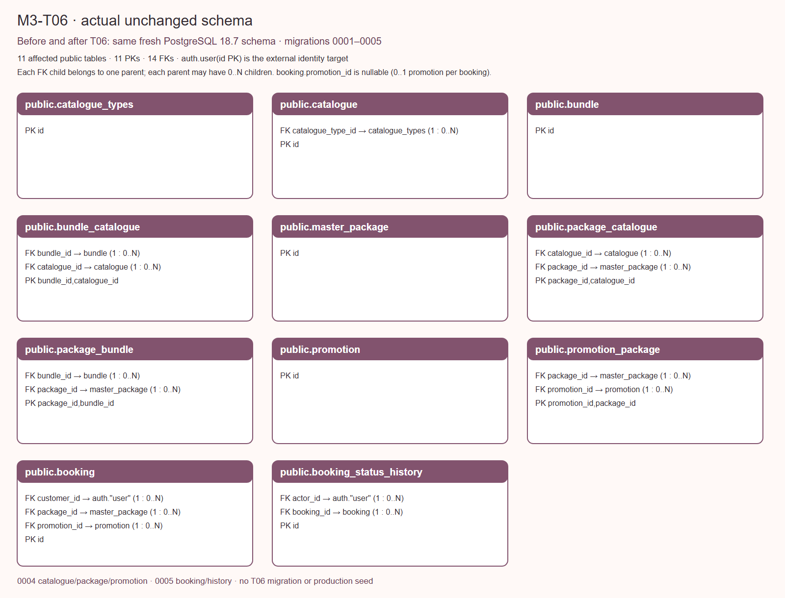

# M3-T06 CFC checkpoint — validation repair

- Ticket: [M3-T06](../tickets/m3-booking-core/M3-T06-admin-booking-decisions.md); batch 4; state `awaiting_review`.
- Code repository: `https://github.com/adityaa11/bride-assistant.git`; exact remediation code commit: `ad8448b29eb7bf3bc21677923f44f1ac2c7056f4`.
- Reviewed code commit: `e0385d0e686871fcfe5bafe876ad1803103f7bfa`.
- Authorized source: [CK first consolidated review](../feedback/M3-T06-admin-booking-e0385d0-ck.md), result `CHANGES_REQUIRED`, frozen clause `CK-001.a`. This is the first bounded CFC pass; no HMN authorization is required.
- Code change: `tests/m3-t06.browser.spec.ts:127` explicitly types the mapped history event's `to_status` field. No runtime behavior, route, schema, migration, or capture configuration changed. The pre-existing unstaged `AGENTS.md` change was excluded from the code commit.

## Frozen finding closure

| Clause | Ticket authority and oracle source | Status | Evidence locator, exact command and result | Frozen oracle |
| --- | --- | --- | --- | --- |
| `CK-001.a` | M3-T06 `Validation and hard stop` / `RC-M3-T06V`; see the [CK frozen closure matrix](../feedback/M3-T06-admin-booking-e0385d0-ck.md#frozen-finding-closure-matrix). | `PROVEN` | At code commit `ad8448b`, `tests/m3-t06.browser.spec.ts:127` has an explicit event type. `npm run check` — **PASS, exit 0**: ESLint passed; `tsc --noEmit` passed with no `TS7006`; Node tests passed **15/15**; Next.js 16.4.6 production build compiled, finished TypeScript, generated **31/31** static pages, and finalized optimization. | **PASS**: the required current-revision check, including TypeScript, 15 Node tests and production build, exits 0; the reported implicit-any error is absent. |

Internal readiness: `READY_FOR_CK`. The checkpoint is `awaiting_review`, not a self-issued CK `PASS`.

## Direct regressions checked

`node scripts/m3-t06-browser.mjs .local-storage/m3-t06-cfc` — **PASS, exit 0** at code commit `ad8448b`: a fresh disposable PostgreSQL 18.7 Compose project applied migrations `0001`–`0005`; the actual unchanged ERD comparison passed (**11 public PKs / 14 FKs**); the protected route/DB/Playwright test `tests/m3-t06.browser.spec.ts:10` passed **1/1**; and `down --volumes --remove-orphans` removed the disposable container, volume and network. The test directly asserts the same-record queue/detail, negative and concurrent transitions, actor/time/history order, manual-confirmation and T07 callback boundary, empty/missing state, keyboard selection, feedback, and 390px fit. No Vercel or Neon check was needed because this repair changes no provider path and the ticket has no provider-specific criterion. Local results make no changed-production-deployment claim.

The fresh run wrote disposable output under `.local-storage/m3-t06-cfc`; unchanged baseline captures are retained at the earlier committed evidence locations rather than copied. The source change is a TypeScript annotation erased at runtime, and the full browser/DB test reran at the remediation commit. Thus the earlier observations remain applicable to the proven `RC-M3-T06A`–`D` rows and the new run checks their direct regression boundary. Their durable reference is artifact commit `0eb9169fb6bdc0a1f303bf2c3dc145ba0db73353`, original observed code commit `e0385d0e686871fcfe5bafe876ad1803103f7bfa`: [observations](../evidence/m3-t06/observations.json) blob `21b2c04521947249a75ba6b9ced6d2b983fc9f17`; [schema catalogue](../evidence/m3-t06/schema.json) blob `7146260d8680233c397fcc569d693e96cf7731ee6`; [actual PNG ERD](../evidence/m3-t06/actual-erd.png) blob `39273f87f7b12cc08677e4a990365134aa1a7212`; [actual SVG ERD](../evidence/m3-t06/actual-erd.svg) blob `cbd5897407f4bb509ac5fdfb2ed8d625d8cdb96b`. The original observation context is the disposable local protected admin route/DB/browser run and desktop/mobile captures described in the [GO checkpoint](M3-T06-admin-booking-e0385d0.md); its applicability is unchanged because the only intervening code change is the erased test annotation and the named run passed again.

## Migration boundary and actual ERD

The schema is unchanged before and after T06. Existing migrations [0001](https://github.com/adityaa11/bride-assistant/blob/ad8448b29eb7bf3bc21677923f44f1ac2c7056f4/migrations/0001_schema_migrations.sql), [0002](https://github.com/adityaa11/bride-assistant/blob/ad8448b29eb7bf3bc21677923f44f1ac2c7056f4/migrations/0002_better_auth_identity.sql), [0003](https://github.com/adityaa11/bride-assistant/blob/ad8448b29eb7bf3bc21677923f44f1ac2c7056f4/migrations/0003_admin_bootstrap_state.sql), [0004](https://github.com/adityaa11/bride-assistant/blob/ad8448b29eb7bf3bc21677923f44f1ac2c7056f4/migrations/0004_catalogue_packages_promotions.sql), and [0005](https://github.com/adityaa11/bride-assistant/blob/ad8448b29eb7bf3bc21677923f44f1ac2c7056f4/migrations/0005_booking_aggregate.sql) were compared with fresh migrated database introspection by `scripts/m3-t06-erd.mjs`. The rendered diagram names affected tables, keys, and cardinalities. The ticket's earlier explicit unchanged-schema confirmation remains the SQL authorization; CFC made no new migration.
