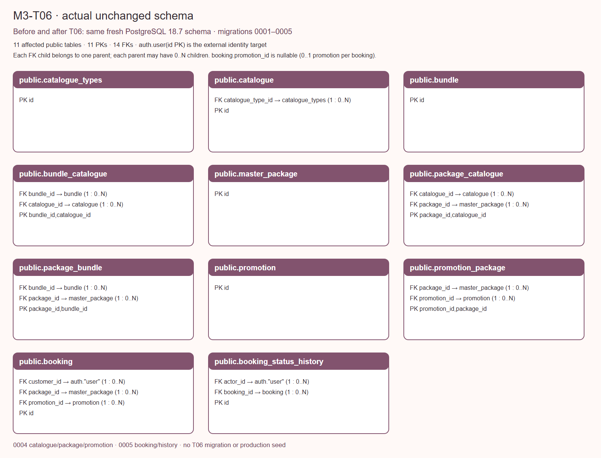

# M3-T06 GO checkpoint — prepared admin booking decisions

- Ticket: [M3-T06](../tickets/m3-booking-core/M3-T06-admin-booking-decisions.md); batch 4; state `awaiting_review`.
- Code repository: `https://github.com/adityaa11/bride-assistant.git`; exact code commit: `e0385d0e686871fcfe5bafe876ad1803103f7bfa`.
- Predecessors: M3-T04 CK `PASS` at `42b7bfe`, M3-T05 CK `PASS` at `378248c`, M2-T05 actor/input handoff, and M2.1-T01 CK `PASS`. The prepared admin path consumes the same T05-created booking ID, snapshot, and history.
- SQL confirmation: On 26 November 2026, the user was shown the rendered unchanged-schema ERD and the definitions, purposes, responsibilities, and boundaries of `0001`–`0005`. The user explicitly replied **“I confirm the M3-T06 unchanged-schema proposal”** before T06 migration-dependent implementation or local migration checks. This confirms T06's unchanged schema only, not M3-SQL-07.
- Artifact store: tracked `atlas-workflow.yaml`, ignored local checkout override, matching artifact `origin`, and `atlas-workflow` manifest were verified. The artifact index was clean before writing; only four pre-existing untracked `.gitkeep` paths were present. This operation owns the T06 ticket, set README, this checkpoint, and `evidence/m3-t06/*`.

## Review Contract Closure

| Row | Ticket authority and pass condition | Required proof and evidence locator | Exact validation and outcome | Status |
| --- | --- | --- | --- | --- |
| `RC-M3-T06A` | AC-A: admin-only valid core transitions, stale/invalid/customer attempts do not mutate status or history; actor/time and order persist atomically. | [Observations](../evidence/m3-t06/observations.json) and `tests/m3-t06.browser.spec.ts`: customer PATCH 403, invalid shape 422, invalid/stale targets 409, two concurrent pending commands yield 200/409, then exactly two events; transactional success callback yields a third ordered event with admin actor. The live prepared route cannot perform success without T07's reservation callback. | `node scripts/m3-t06-browser.mjs .local-storage/m3-t06-go` — PASS, fresh disposable PostgreSQL 18.7 and protected browser/route/DB test; `npm run check` — PASS. | `PROVEN` |
| `RC-M3-T06B` | AC-B: admin queue/detail reads the same T05 booking ID and submitted/package snapshot as customer; no separate aggregate, unauthorized disclosure, or seed. | Same test: empty admin list `[]`, missing UUID 404, anonymous list 401, customer list/PATCH 403. T05 customer submission ID and snapshot equal admin detail; admin projection excludes internal submission key and hash. Customer own detail/history matches initial admin detail. [Desktop detail](../evidence/m3-t06/detail-desktop.png), [mobile detail](../evidence/m3-t06/detail-mobile.png), [empty desktop](../evidence/m3-t06/empty-desktop.png), [empty mobile](../evidence/m3-t06/empty-mobile.png). | Same Docker browser command — PASS; [schema catalogue](../evidence/m3-t06/schema.json) — 11 PK/14 FK. | `PROVEN` |
| `RC-M3-T06C` | AC-C: touched admin queue/detail retains M1 operational hierarchy, responsive fit, keyboard and state feedback. | Fresh [initial detail](../evidence/m3-t06/initial-detail-desktop.png), [payment pending](../evidence/m3-t06/payment-pending-desktop.png), [loading](../evidence/m3-t06/loading-desktop.png), [error](../evidence/m3-t06/error-desktop.png), empty and final desktop/mobile captures. Browser checks keyboard focus/Enter on queue selection, status/alert, disabled success, and 390px no horizontal overflow. Visually inspected captures against the admin frame and Soft Rose Atelier baseline; VIS-001–014 pass for touched screen. | Same Docker browser command — PASS; `npm run check` — PASS (lint, typecheck, 15/15 Node tests, build); `git diff --cached --check` — PASS. | `PROVEN` |
| `RC-M3-T06D` | Revision 1.8 AC-D: false/missing manual payment confirmation, non-admin actor, stale state, or failed date integration cannot create a successful event; validated admin decision records actor/time for T07 handoff. | Same protected route/DB test: customer success 403; missing/false/true confirmation on prepared route all 409 while reservation integration is absent, leaving status `Menunggu Pembayaran` and two events. Repository rejects missing callback; a disposable callback returning false rolls back. A test-only true callback demonstrates the T07 transactional handoff, producing one `Booking Berhasil` event with admin ID and ordered time. [Observations](../evidence/m3-t06/observations.json) record event and counts. The UI presents explicit manual review confirmation but disables the success action until T07 installs reservation. | Same Docker browser command — PASS; no production success or provider claim. | `PROVEN` |

Internal readiness: `READY_FOR_CK`. This is not a self-issued CK `PASS`.

## Actual Use Path

`EUP-M3-T06` is preparation-only. Disposable signed-in admin `/admin/bookings` → `AdminBookingsPage` → `listPreparedAdminBookings` → M2-T05 `authorizeRequest` with server session and strict input → `listAdminBookings` → the same `public.booking` rows created by T05 → `AdminBookingLive` queue/detail. Queue selection fetches `GET /api/admin/bookings/[bookingId]` → `readPreparedAdminBooking` → `readAdminBooking` → that booking and its ordered `booking_status_history`; the browser test compares its ID and snapshots to T05's customer detail. The UI button calls `PATCH /api/admin/bookings/[bookingId]` → `decidePreparedAdminBooking` → `transitionAdminBooking`, which locks the current booking row, validates the expected and allowed statuses, updates status, and appends exactly one actor/time event in one transaction. The browser test executes this UI-to-DB path on a second T05-created booking.

H-M3-06 type/identity: `booking.id` UUID is the shared correlation ID; `status` is the canonical current value; the command carries `bookingId`, advisory `expectedStatus`, validated `targetStatus`, and optional `paymentReviewed` boolean. Repository current state under `FOR UPDATE` is authoritative. Success requires `paymentReviewed === true` and a T07-supplied reservation callback using the same transaction client; missing or failed integration returns `CONFLICT` without event. Result includes booking ID/status/time and ordered history event ID, booking ID, from/to status, deciding actor ID, and occurrence time. Repeated/stale commands conflict instead of replaying an event. The local gate requires `DATABASE_MODE=local` and `M3_T06_PREPARED_ROUTES=1`; production success and queue activation remain T07's work. Named `/admin/bookings/[state]` routes remain non-authoritative M1 review fixtures, with no fixture fallback in the live path.

## Migration Inventory

[SVG](../evidence/m3-t06/actual-erd.svg) and [fresh schema catalogue](../evidence/m3-t06/schema.json) show the unchanged before/after T06 schema. Fresh disposable Docker PostgreSQL 18.7 applied existing [0001 ledger](https://github.com/adityaa11/bride-assistant/blob/e0385d0e686871fcfe5bafe876ad1803103f7bfa/migrations/0001_schema_migrations.sql), [0002 identity](https://github.com/adityaa11/bride-assistant/blob/e0385d0e686871fcfe5bafe876ad1803103f7bfa/migrations/0002_better_auth_identity.sql), [0003 first-admin bootstrap](https://github.com/adityaa11/bride-assistant/blob/e0385d0e686871fcfe5bafe876ad1803103f7bfa/migrations/0003_admin_bootstrap_state.sql), [0004 catalogue/package/promotion](https://github.com/adityaa11/bride-assistant/blob/e0385d0e686871fcfe5bafe876ad1803103f7bfa/migrations/0004_catalogue_packages_promotions.sql), and [0005 booking/history](https://github.com/adityaa11/bride-assistant/blob/e0385d0e686871fcfe5bafe876ad1803103f7bfa/migrations/0005_booking_aggregate.sql). The diagram names all affected public tables, PKs, FKs, and cardinalities plus external `auth.user(id PK)`. Fresh introspection matches 11 public PKs and 14 FKs. T06 adds no migration, production-data change, seed SQL, or migration-runner branch. Test customers, admin, catalogue and bookings are runtime factories in a unique Compose project; `down --volumes` removes its rows, database volume and network in `finally`. There is no T06 rollback because no schema change was made.

## Actual Empty-State Evidence

Immediately after fresh `0001`–`0005` and disposable identity registration, the protected admin API returned `[]`, the queue rendered “Belum ada booking sesuai filter,” and an absent booking UUID returned 404. A T05 customer submission then appeared by the same ID, without admin seed data. Its initial event matched the customer read. The first valid admin pending decision appended one event; concurrent/stale retries did not append another.

## Validation and limits

- `npm run check` — PASS after source changes: lint, typecheck, 15/15 Node tests, production build.
- `node scripts/m3-t06-browser.mjs .local-storage/m3-t06-go` — PASS after final code/test changes: fresh migrations, actual ERD comparison, protected route/DB/browser scenario, captures, volume teardown.
- `git diff --cached --check` — PASS before code commit; the pre-existing unstaged `AGENTS.md` change was excluded.
- No Vercel/Neon probe was run: T06 changes no provider path and has no provider-specific criterion. Accepted M2 provider evidence is the baseline; local proof does not verify a production deployment.
- Production `Booking Berhasil` remains unavailable until T07 supplies actual date reservation and activates the route. The disposable true callback tests the transaction seam, not production availability. M4 still owns proof bytes/review and exception transitions.
