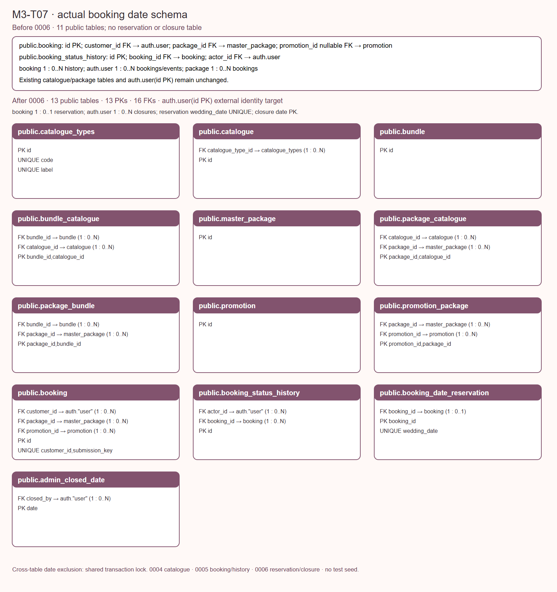

# M3-T07 GO checkpoint — transactional availability

- Ticket: [M3-T07](../tickets/m3-booking-core/M3-T07-transactional-availability.md); batch 5; state `awaiting_review`.
- Code repository: `https://github.com/adityaa11/bride-assistant.git`; exact code commit: `1981c95d1d8bd487e78b830c5bab6d282a6e16d9` (implementation `03917b7`, test extension `4662580`, ERD constraint check `1981c95`).
- Predecessors: M3-T05 CK `PASS` at `378248c`; M3-T06 CK `PASS` at `ad8448b`; M2-T05 actor/input and M2-T06 result contracts are consumed.
- SQL confirmation: The revised [rendered proposal](../tickets/m3-booking-core/proposed-erd.svg) and [SQL-07 definition, purpose, responsibilities and boundaries](../tickets/m3-booking-core/migration-proposal.md) were shown on 26 November 2026. The user explicitly replied **“i confirm”** before writing or running `0006`. The confirmation is recorded in the ticket.
- Artifact store: tracked `atlas-workflow.yaml`, ignored local checkout override, matching artifact `origin`, and `atlas-workflow` manifest were verified. The artifact index was clean; the four pre-existing untracked `.gitkeep` files were left untouched. This operation owns the T07 ticket, set README, this checkpoint, and `evidence/m3-t07/*`.

## Review Contract Closure

| Row | Ticket authority and pass condition | Required proof and evidence locator | Exact validation and outcome | Status |
| --- | --- | --- | --- | --- |
| `RC-M3-T07A` | AC-A: admin-only durable close/open blocks date without a booking, customer cannot close. | [Observations](../evidence/m3-t07/observations.json) and `tests/m3-t07.browser.spec.ts`: anonymous GET 401, customer POST 403, first close 200, duplicate close 409, open 200, absent open 200; DB `closed_by` equals admin identity and cross-surface date-only read changes immediately. Admin browser performs a close/open and observes the customer projection. | `node scripts/m3-t07-browser.mjs .local-storage/m3-t07-go` — PASS, fresh disposable PostgreSQL and protected route/DB/browser test. | `PROVEN` |
| `RC-M3-T07B` | AC-B and revision 1.8: pending initial requests do not reserve; concurrent successes and closure/success resolve atomically; pending cancellation/reschedule retain the old date until approval. | Same test and observations: two initial bookings on one date both submit while it stays available; concurrent success returns 200/409 with one reservation and 3/2 events; closure/success returns 200/409 with exactly one closure or reservation; a closed date rejects new submission. A failed callback rolls back its inserted reservation, route retry succeeds once, stale retry conflicts without new event. Disposable M4 pending cancellation and pending reschedule status/history fixtures each retain their reservation and date-only unavailable projection. | Same Docker command — PASS; direct PostgreSQL row/history/count assertions and browser route outcomes. | `PROVEN` |
| `RC-M3-T07C` | AC-C: private date-only customer payload and current server-backed customer/admin calendars with keyboard, status, empty and error states. | Route response is only `{date,state}` and omits booking/customer identity. [Customer desktop](../evidence/m3-t07/customer-calendar-desktop.png), [mobile](../evidence/m3-t07/customer-calendar-mobile.png), [error](../evidence/m3-t07/customer-error-mobile.png); [admin desktop](../evidence/m3-t07/admin-availability-desktop.png), [mobile](../evidence/m3-t07/admin-availability-mobile.png), [empty](../evidence/m3-t07/admin-empty-desktop.png), [error](../evidence/m3-t07/admin-error-mobile.png), [decision](../evidence/m3-t07/admin-decision-desktop.png). Browser asserts unavailable day disabled, available day keyboard focus/Enter selection, status/alert text, live close/open, and 390px no horizontal overflow. Rendered captures were visually inspected against the M1 Soft Rose Atelier hierarchy. | Same Docker browser command — PASS; `npm run check` — PASS (lint, typecheck, 15/15 Node tests, build). | `PROVEN` |
| `RC-M3-T07D` | AC-D and AGENTS.md: confirmed fresh migration matches rendered actual before/after ERD; no test-only durable data. | [Rendered actual ERD](../evidence/m3-t07/actual-erd.png), [SVG](../evidence/m3-t07/actual-erd.svg), [fresh schema catalogue](../evidence/m3-t07/schema.json), [0006 migration](https://github.com/adityaa11/bride-assistant/blob/1981c95d1d8bd487e78b830c5bab6d282a6e16d9/migrations/0006_date_reservation_closure.sql). Fresh `0001`–`0006` migration comparison: 13 affected public PKs, 16 FKs, and reservation `wedding_date` UNIQUE. The diagram names affected tables, PKs, FKs, 1:0..1 booking/reservation and 1:0..N admin/closure cardinalities. Docker volume teardown removed every test row. | Same Docker command — PASS; `npm run check` — PASS; `git diff --cached --check` — PASS. | `PROVEN` |
| `RC-M3-T07E` | Revision 1.8 AC-E: activate T05/T06 route-to-effect paths only with shared date transaction; production fixture/localStorage decision unreachable. | `/booking` and `/booking-saya` activate the T05 customer flow in production; `/admin`, `/admin/bookings`, `/admin/availability` activate the T06/T07 live admin paths. The `/admin` fixture landing was retired, Bookings navigation points to `/admin/bookings`, and named M1 review routes stay non-authoritative. `tests/workspace-boundaries.test.mjs` and the browser's admin landing assertion inspect this. Route/DB race observations prove the protected endpoints share `date-availability.mjs`. | `npm run check` — PASS; same Docker browser command — PASS. | `PROVEN` |

Internal readiness: `READY_FOR_CK`. This is not a self-issued CK `PASS`.

## Actual Use Path

`EUP-M3-T07`: customer `/booking` → authenticated T05 form and `POST /api/customer/bookings` → M2-T05 `authorizeRequest` → `createBooking` → `lockDate` and `dateIsAvailable` → pending `public.booking` plus initial `booking_status_history` in one transaction. Customer calendar → `GET /api/customer/availability` → validated range → `listUnavailableDates` → dates and status only. Admin `/admin` or `/admin/bookings` → live T06 list/detail and `PATCH /api/admin/bookings/[bookingId]` → validated admin actor → `transitionAdminBooking` locks the booking row, calls T07 `reserveSuccessfulDate` under the shared date lock, then commits `booking_date_reservation`, status and event together. Admin `/admin/availability` → protected `POST /api/admin/availability` → `changeClosedDate` under the same date lock → `admin_closed_date`; both calendars refresh from the date-only server projection. The Docker browser test executes these routes against the same fresh PostgreSQL database. The former `/admin` booking fixture is no longer a production caller; named M1 review routes remain fixtures by contract. No localStorage availability decision is in the live path.

H-M3-07 type and identity: `booking.id` is the UUID correlation and reservation PK/FK; `wedding_date` is a unique SQL date; `admin_closed_date.date` is the independent closure PK and `closed_by` is the admin identity FK. Initial request statuses have no reservation. Success creates one reservation in the booking status/history transaction. Repeated/stale success conflicts; absent open is idempotent. M4 approved cancellation/reschedule must release/move the reservation under the same date lock; T07 does not activate those commands. The customer projection has only ISO date and `unavailable` state. A closure/reservation conflict returns 409 without partial status, history, reservation or closure mutation.

## Migration Inventory

The intended [0006_date_reservation_closure.sql](https://github.com/adityaa11/bride-assistant/blob/1981c95d1d8bd487e78b830c5bab6d282a6e16d9/migrations/0006_date_reservation_closure.sql) creates `public.booking_date_reservation(booking_id PK/FK → booking.id, wedding_date UNIQUE, created_at)` and `public.admin_closed_date(date PK, closed_by FK → auth.user.id, created_at)`. It inserts no production rows. The unchanged `0001` ledger, `0002` identity, `0003` bootstrap, `0004` catalogue and `0005` booking/history migrations are the before-state baseline. The actual SVG/PNG shows before and after, and the fresh [schema catalogue](../evidence/m3-t07/schema.json) was generated after applying `0001`–`0006` to a new PostgreSQL 18.7 Docker volume. It verifies 13 public PKs, 16 FKs and the reservation date unique constraint, matching the confirmed proposal. There is no test-only migration, seed SQL, or runner conditional. The migration runner is forward-only and checksum guarded; the test harness creates disposable rows through route/repository factories and removes its unique Compose volume/network in `finally`. No provider adapter or deployment path changed; the accepted M2 Vercel/Neon baseline is reused and no remote probe is claimed.

## Actual Empty-State Evidence

On a fresh migrated database with no bookings or closures, `GET /api/customer/availability?from=2027-02-10&to=2027-02-10` returned `[]` (valid future date available). Admin closure first returned 200 and changed the same customer date projection to one `{date,state:"unavailable"}` item; duplicate closure conflicted, opening it returned 200 and restored `[]`, and opening it again returned 200 without mutation. Two first pending submissions on one date succeeded while the customer projection remained `[]`; the first success created the reservation and immediately made the date unavailable. All records and the database volume were deleted by the disposable harness.

## Validation and handoff

- `npm run check` — PASS: ESLint, TypeScript, 15/15 Node tests, production Next build.
- `node scripts/m3-t07-browser.mjs .local-storage/m3-t07-go` — PASS: fresh Docker migration/ERD comparison, two-role routes, concurrent date decisions, rollback/retry, private payload, desktop/mobile browser states, volume teardown.
- `git diff --cached --check` — PASS for each scoped code commit.
- Current implementation is local-profile verified. It does not claim a production deployment or provider adapter probe; the ticket names no provider-specific criterion and changes no provider path.
