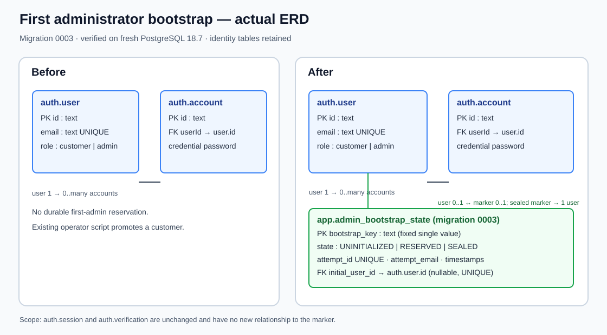

# First-admin bootstrap implementation checkpoint

- Code repository / exact commit: https://github.com/adityaa11/bride-assistant.git at `fcaae2455308f10f2e46a0092fa097135b56994d`.
- Atlas status: implementation handoff; independent CK review has not been recorded.
- User confirmation: 25 November 2026, explicit “Confirm 0003 proposal (Recommended)” after the rendered preview and explanation; see [validation](../evidence/admin-bootstrap/validation.md).
- Migration file: code commit `fcaae2455308f10f2e46a0092fa097135b56994d`, `migrations/0003_admin_bootstrap_state.sql`.
- Actual schema: [rendered ERD](../evidence/admin-bootstrap/actual-erd.svg), compared with a fresh migrated PostgreSQL 18.7 database as recorded in [validation](../evidence/admin-bootstrap/validation.md).

`0003` adds the `app` schema, `app.admin_bootstrap_state` (bootstrap_key PK; initial_user_id nullable FK → auth.user.id), a one-time UNINITIALIZED row, and a trigger that guards state transitions and prevents deletion after sealing. It owns only first-admin reservation/sealing; Better Auth owns identity and credential storage. Existing `auth.user`/`auth.account` remain the identity baseline. Fresh local migration, CLI credential sign-in and `/admin/masuk` browser tests passed. No production migration or provider probe was run.

CK must inspect this rendered image, the migration file, and the fresh database comparison before approving the migration work. The earlier M2-T04 checkpoint remains historical evidence for the superseded email-promotion script.
