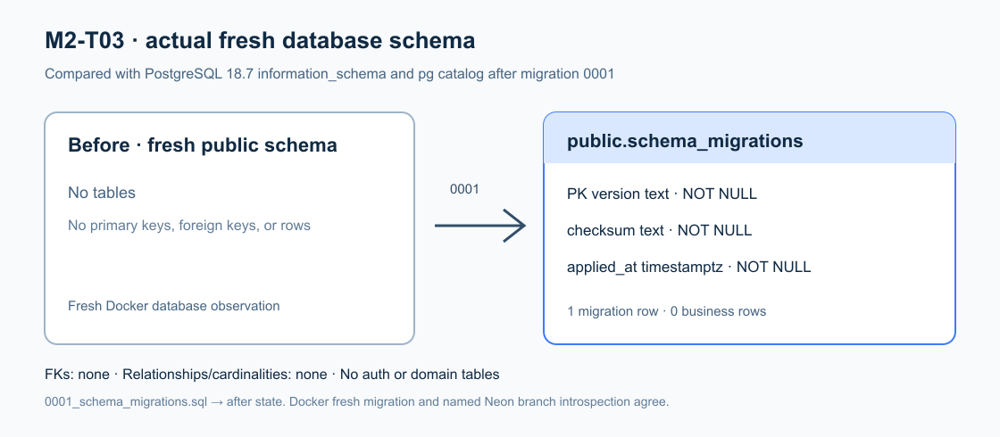

# M2-T03 validation and schema comparison

- Code repository: `https://github.com/adityaa11/bride-assistant.git` at `d52067955f833fdf803c96f868cb4b3f67a36218`.
- Artifact observation: 24 November 2026, Asia/Bangkok. No real customer, booking, auth, content, or proof record was created.
- Vercel project `prj_P7fKpQy42FgHOCvnCgwss4a7zDMp`, deployment `dpl_ExhMAi4Hs6pXHvJP79SHkskMHEeq`; [redacted deployment metadata](deployment.json) binds the database route to Node `24.x`, Singapore `sin1`, production target and `READY` state. Local CLI deployment used the clean source checkout at the code commit above; Vercel is not Git-connected. The first deployment failed because the local `.atlas` junction entered the upload; the committed `.vercelignore` excluded it and the succeeding deployment completed its build.

## Exact commands and observations

| Command / operation | Outcome and locator |
| --- | --- |
| `npm run check` | PASS at the bound code commit: ESLint, TypeScript, 13/13 Node tests and Next production build; [full output](check.log). The workstation's default Node was 24.19.0, so the approved Node 24.22.3 was also used directly for ESLint, TypeScript, 13/13 Node tests, migration and server integration. |
| `npx --yes node@24.22.3 node_modules/eslint/bin/eslint.js .`; `npx --yes node@24.22.3 node_modules/typescript/bin/tsc --noEmit`; `npx --yes node@24.22.3 --test <all .test.mjs paths>` | PASS, PASS, 13/13 PASS. `npx --yes node@24.22.3 node_modules/next/dist/bin/next build` also passed locally; Vercel's build and live route independently ran on Node 24.x/24.22.3. |
| `npx --yes node@24.22.3 scripts/m2-data-evidence.mjs` | [Fresh Docker log](docker.log): PASS. PostgreSQL 18.7 began with zero public tables; migration `0001` and repeat run yielded exactly one ledger row; `next start` called `/api/system/database` and returned HTTP 200 `ready`, migration `0001`, Node 24.22.3. Invalid database URL caused a redacted `DATABASE_STARTUP_FAILED` and HTTP 500. Disposable test schema was removed and `docker compose down --volumes` removed the isolated database. |
| `DATABASE_MODE=production DATABASE_URL=<unset> npx --yes node@24.22.3 scripts/m2-migrate.mjs` | [Missing-secret output](missing-secret.log): exit 1 with only `MIGRATION_FAILED: DATABASE_URL_MISSING`; no connection attempted or secret echoed. |
| `DATABASE_MODE=production DATABASE_EXPECTED_NAME=bride_assistant DATABASE_EXPECTED_HOST=<T01 named host> DATABASE_URL=<ignored local secret> npx --yes node@24.22.3 scripts/m2-migrate.mjs` | First and repeat run PASS against the T01 Neon production branch; [repeat output](neon-migrate-repeat.log) reports `bride_assistant`, 18.7, version `0001`. No URL or credential is in the log. |
| Same named environment, `npx --yes node@24.22.3 scripts/m2-neon-evidence.mjs` | [Neon observation](neon.log): PASS. The client stream was encrypted and certificate authorized. An invalid certificate authority was rejected with `UNABLE_TO_GET_ISSUER_CERT_LOCALLY`. The expected host and database were validated before connection. |
| `npx --yes vercel deploy --prod --yes --scope izharaditya-2800s-projects`; `npx --yes vercel inspect <deployment> --logs/--json` | The current source checkout deployed `READY`; the remote `npm run build` passed. Vercel function metadata records `api/system/database` in `sin1`, `nodejs24.x`. |
| `npx --yes vercel curl https://bride-assistant-bqnpjkrs2-izharaditya-2800s-projects.vercel.app/api/system/database --scope izharaditya-2800s-projects` | Authenticated request returned `{"status":"ready","database":"bride_assistant","serverVersion":"18.7 (84da7d8)","migrations":["0001"],"nodeVersion":"v24.22.3"}`. Direct unauthenticated request reached Vercel Authentication, so Deployment Protection remains in force. The CLI's temporary automation bypass was removed afterward; project protection reports an empty `protectionBypass` map. |
| Post-commit secret scans | PASS: 210 tracked files and 27 local client artifacts contained none of the five T01 provider secret values. The locally ignored Vercel OIDC token was absent from all 237 tracked/client files. `.env.local`, `.vercel/`, `.local-storage/`, and `.atlas/` are excluded from Git/deployment as applicable. `git diff HEAD --check` PASS; code worktree clean. |

## Migration-to-ERD comparison

The proposed [planning ERD](proposed-erd.svg) showed the sole authorized structural change. `0001_schema_migrations.sql` creates `public.schema_migrations` with `version text` as primary key, `checksum text NOT NULL`, and `applied_at timestamptz NOT NULL`. Fresh Docker introspection before migration found **zero** public tables. Fresh Docker introspection after migration and current Neon introspection both found exactly this table and these three columns, one primary key on `version`, zero foreign keys, zero relationships/cardinalities, one migration row and zero business rows. The actual rendered [SVG](actual-erd.svg) and PNG above agree with each query result. There is no data-only or runner-only migration in this checkpoint.

Test data was confined to a disposable schema inside the unique Docker database and dropped before the whole Compose volume was removed. No test fixture, seed SQL, migration conditional, domain table, auth table, or production data change entered the intended migration graph.
