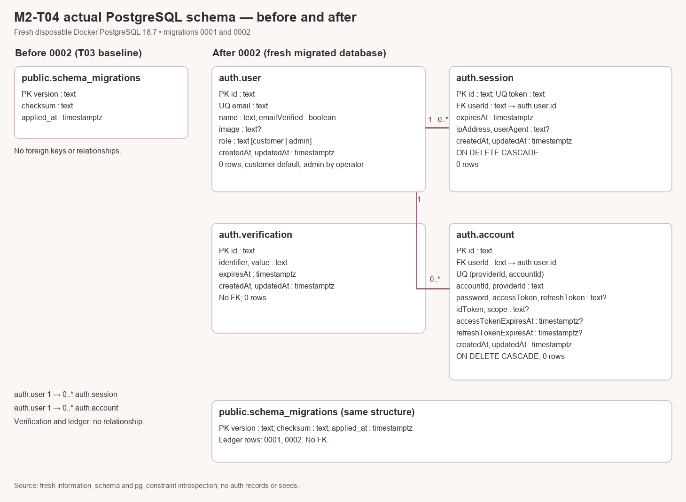

# M2-T04 local validation and schema comparison

- Code repository: `https://github.com/adityaa11/bride-assistant.git` at `af6409c41d06710d7dd14ab027c3af947ae3968f`.
- Disposable Docker project: `bride-m2-t04-local`, PostgreSQL `18.7`; loopback port `55433`; isolated volume removed with `docker compose -p bride-m2-t04-local -f compose.m2-local.yaml down -v` after validation. All email identities used `example.test`; no provider or customer data was used.
- Current-revision commands: `npm run check` — PASS (lint, TypeScript, 13/13 Node tests, production build); `npx playwright test tests/m2-t04.browser.spec.ts` with `DATABASE_MODE=local`, `DATABASE_EXPECTED_NAME=bride_local`, a disposable `DATABASE_URL`, and `M2_T04_CAPTURE_DIR` — PASS, 1 browser integration test; `git diff --check` — PASS.

## Migration-to-ERD comparison

`0001_schema_migrations.sql` is the accepted T03 baseline. A second clean database, `bride_t04_erd`, was created in the disposable container. After applying only `0001` and its checksum ledger entry, `information_schema.tables` returned exactly `public.schema_migrations`; there were no `auth` tables. Its columns were `version` (PK), `checksum`, and `applied_at`, with no FK.

`node scripts/m2-migrate.mjs` then applied `0002_better_auth_identity.sql` using the T03 runner, returning `migrations: ["0001","0002"]`. Fresh `information_schema.columns`, `pg_constraint`, and `pg_indexes` results are in [schema-after.json](schema-after.json). The database contained exactly `auth.user`, `auth.session`, `auth.account`, `auth.verification`, and unchanged `public.schema_migrations`. Every auth table had zero rows. The two FKs were `auth.session.userId → auth.user.id` and `auth.account.userId → auth.user.id`, both `ON DELETE CASCADE`; each is user 1 to child 0..*. `auth.verification` and the ledger had no FK. The diagram labels these actual keys, columns, relationships and cardinalities. The role check permitted only `customer` and `admin`; `auth.user.role` defaulted to `customer`. A fresh second run of the full migration runner returned the same version inventory, confirming repeat safety.

## Runtime observations

- Fresh database before registration: `GET /admin` returned `307 /admin/masuk`; unknown email sign-in returned `401`. First registration with a forged `role: "admin"` returned a customer user; its session still received `307 /admin/masuk`. No admin was seeded.
- Browser harness: customer registration created an HttpOnly Better Auth session cookie and reached `/beranda`; direct `/admin` requests with the customer cookie and a forged `role=admin` cookie redirected to `/admin/masuk`. Customer sign-out denied `/beranda`; a separate customer email/password sign-in restored access. `/masuk/success` remained a visibly named, non-authoritative fixture and did not grant a session.
- Browser harness: invalid credentials displayed a generic error; an explicitly operator-promoted credential user signed in at `/admin/masuk` and reached `/admin`; the admin session was denied `/beranda`. Admin sign-out denied `/admin`. Expiring that session in the disposable database denied `/admin` on the next request.
- Process restart: an issued customer cookie was retained outside the running process, the Next process was stopped and started again against the same disposable database, and `GET /beranda` returned `200`; Better Auth `get-session` returned a persisted customer session.
- Visual and interaction evidence: [register desktop](register-desktop.png), [register mobile](register-mobile.png), [registration error](register-error-mobile.png), [keyboard focus](register-keyboard-focus.png), [sign-in desktop](signin-desktop.png), [sign-in loading](signin-loading-desktop.png), [sign-in error desktop](signin-error-desktop.png), [sign-in error mobile](signin-error-mobile.png), and [admin sign-in mobile](admin-signin-mobile.png). The browser harness asserted native labels, email/password autocomplete, visible skip-link focus, disabled loading control, and no 380px horizontal overflow. The images were inspected against the immutable M1-T08 reference captures. The phone input from the prototype reference is absent because T04 owns no phone persistence; collecting and dropping it would mislead users.

No Vercel or Neon probe was run. T04 changes the local application auth path and SQL schema, and its frozen criteria name disposable PostgreSQL/browser-to-server proof. T01/T03 provider connection evidence remains the approved unchanged baseline; this record makes no claim about a changed production deployment.
