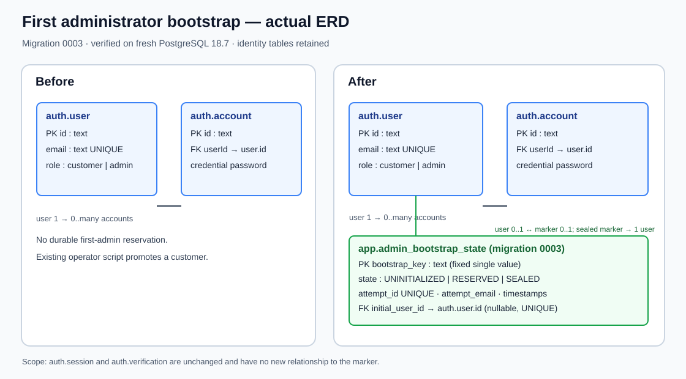

# M2.1-T01 — one-time first-administrator bootstrap

- **State:** `awaiting_review`; batch 1; milestone M2.1; work package M2.1-W01; set [BAP-M2.1-SET-01](README.md).
- **Source code / review commit:** `https://github.com/adityaa11/bride-assistant.git` / `fcaae2455308f10f2e46a0092fa097135b56994d`; implementation is committed already.
- **Authorized checkpoint:** [M2.1 addendum](../../checkpoints/M2.1-T01-first-admin-bootstrap-fcaae24.md), consuming the [original implementation checkpoint](../../checkpoints/admin-bootstrap-fcaae24.md).
- **Authority:** user's first-admin CLI bootstrap request and explicit confirmation of the 0003 proposal on 25 November 2026; [Project](../../contexts/project.md) admin access, [Stack](../../contexts/stack.md) Better Auth/PostgreSQL, [M2.1 milestone](../../contexts/implementation/milestones/M2.1-first-admin-bootstrap.md), and M2-T03/T04/T05 approved handoffs.
- **Dependency:** M2 migration runner, persistent Better Auth identity/session and protected admin route, server-derived role; successor M3-T02 admin commands after CK approval.
- **Activation:** `active-in-this-ticket`. **Legacy:** earlier `scripts/m2-provision-admin.mjs` email promotion is superseded and must be unreachable. **SQL:** `0003` is an intended migration; its single marker row is required production state, while test identities are ephemeral. **Empty state:** a fresh migrated installation has UNINITIALIZED marker and no admin; customer registration never grants admin.
- **Provenance:** this ticket was authored after implementation and the original checkpoint at the user's request. It freezes the bounded review contract now; it does not assert that the ticket existed before code was written or that CK has passed.

## Outcome and exact scope

A trusted operator can create the first admin credential once, sign in at `/admin/masuk`, and cannot rerun bootstrap or convert an existing customer. An interrupted reserved attempt may be reconciled only by verifying the credential tied to that attempt. This ticket owns the one-time CLI, marker migration, and integration with existing auth. It excludes additional-admin management, public admin registration, resetting a sealed marker, catalogue/booking commands, production deployment, and provider re-probing.

## Entrypoint, endpoint and handoff

`npm run admin -- bootstrap --email <email> --name <name>` is invoked from a trusted interactive terminal. `scripts/admin-command.mjs` validates named arguments and prompts for a password twice without echo; password arguments/environment input and noninteractive bootstrap are rejected. `scripts/admin-bootstrap-core.mjs` receives `{email,name,password}` in process memory and server-only database/auth configuration. Invalid values, an existing admin/email, a RESERVED/SEALED marker, or missing configuration return a nonzero typed/fail-closed result. `reconcile --attempt-id <UUID>` accepts only the recorded attempt ID and does not create an identity.

The endpoint is `app.admin_bootstrap_state` SEALED with `initial_user_id → auth.user.id`, a Better Auth credential account for that newly created admin, and successful existing `/admin/masuk` → `/admin` sign-in. A failed or interrupted attempt leaves an explicit RESERVED marker; it cannot silently reopen first-admin creation. `H-M2.1-01`: M3-T02 consumes the admin session/role through the existing M2 protected route and authorization boundary, while the marker remains bootstrap-only. Retries after SEALED fail; reconciliation is tied to the original reservation.

`EUP-M2.1-T01`: trusted CLI caller → command parser and hidden prompt → reservation/Better Auth sign-up/promotion/seal → persisted marker and identity → existing admin sign-in handler → protected admin workspace. CK must trace the committed actual path; a test-only helper does not establish activation. The previous email-promotion script must be absent as an operational path. `RD-M2.1-01 reuse-existing` Better Auth and M2 database/session boundary; `RD-M2.1-02 keep-local` CLI prompt and one-time coordinator, whose authority differs from browser registration.

## Migration, initial state and invariants

The user confirmed the rendered `0003` proposal before the SQL was written or run. [`0003_admin_bootstrap_state.sql`](https://github.com/adityaa11/bride-assistant/blob/fcaae2455308f10f2e46a0092fa097135b56994d/migrations/0003_admin_bootstrap_state.sql) creates the `app` schema, `app.admin_bootstrap_state` with `bootstrap_key` PK, nullable `initial_user_id` FK to `auth.user.id`, unique attempt/user IDs, valid state-shape checks, one UNINITIALIZED row, and a guard trigger. It owns reservation and irreversible sealing, not credentials or sessions. The [actual rendered ERD](../../evidence/admin-bootstrap/actual-erd.svg) shows before/after PK/FK/cardinalities; the [fresh Docker comparison](../../evidence/admin-bootstrap/validation.md) binds it to migrations 0001–0003. There is no M3 SQL here.

On a clean migrated database, protected admin access fails until bootstrap succeeds. Reserve is serialized through the marker row; only the newly returned Better Auth user ID may be promoted. SEALED prevents a second bootstrap and marker deletion/update. A failed reserved attempt stays reserved; reconciliation verifies the reserved credential and does not promote an unrelated or customer identity. Passwords, hashes, database URL, secret, and session tokens must not appear in CLI output, logs, tickets, or evidence. The CLI may report the email, role, sealed state, and opaque attempt ID.

## Acceptance criteria and Review Contract

| AC / RC | PASS iff required behavior | Harness and evidence to inspect | Forbidden substitute / direct regression |
| --- | --- | --- | --- |
| `AC-M2.1-01` / `RC-M2.1-01` | Fresh 0001–0003 installation starts without admin; trusted CLI creates exactly one new Better Auth credential, assigns admin only to its returned ID, seals marker, and rejects a repeat or preexisting-admin/email collision. | Inspect committed CLI/SQL and [local validation](../../evidence/admin-bootstrap/validation.md); fresh disposable PostgreSQL first/repeat observations and affected tests. | Customer promotion, implicit default admin, second successful bootstrap, or hidden seed identity. |
| `AC-M2.1-02` / `RC-M2.1-02` | CLI requires hidden interactive password and confirmation; password argument/mismatch/noninteractive paths fail before identity creation and output contains no password or token. | CLI parser/prompt inspection and [CLI tests](https://github.com/adityaa11/bride-assistant/blob/fcaae2455308f10f2e46a0092fa097135b56994d/tests/admin-bootstrap-cli.test.mjs) plus relevant negative probe; inspect output. | Password in argv/env, echo, or logging credential values. |
| `AC-M2.1-03` / `RC-M2.1-03` | RESERVED attempts cannot start a second identity; `reconcile` requires the matching attempt and seals only a verifiable credential for its reserved email, or fails closed without changing ownership. | Migration/transaction inspection and disposable PostgreSQL interruption/reconciliation, mismatched-attempt and unverified-credential observations. | Reset marker, promote an arbitrary existing user, or silent retry after partial failure. |
| `AC-M2.1-04` / `RC-M2.1-04` | Bootstrap credentials sign in via existing `/admin/masuk` and reach protected `/admin`; customer/anonymous access remains denied by the M2 route boundary. | [Browser test](https://github.com/adityaa11/bride-assistant/blob/fcaae2455308f10f2e46a0092fa097135b56994d/tests/admin-bootstrap.browser.spec.ts) and M2-T04 direct denial regression; inspect actual route and session path. | CLI-only test, fixture login, or client-supplied admin role. |
| `AC-M2.1-05` / `RC-M2.1-05` | The 0003 actual rendered ERD matches committed migration keys, FK/cardinality and a fresh migrated database; marker row/trigger enforce one-time state; test data remains disposable. | [Rendered ERD](../../evidence/admin-bootstrap/actual-erd.svg), [fresh database comparison](../../evidence/admin-bootstrap/validation.md), migration file and migration inventory; CK must visually inspect diagram and comparison. | Mermaid/path-only proof, test seed migration, or live-provider assumptions. |
| `AC-M2.1-06` / `RC-M2.1-06` | Former email-promotion script is removed from the reachable operational path and the documented command is the one-time CLI. | Commit diff, package command, [operator guide](https://github.com/adityaa11/bride-assistant/blob/fcaae2455308f10f2e46a0092fa097135b56994d/docs/admin-bootstrap.md), and caller search. | Continuing customer-to-admin promotion path or admin self-registration route. |

`SEC-M2.1-01` implement-now maps to RC-01/03/05 (exclusive, fail-closed first-admin authority). `SEC-M2.1-02` implement-now maps to RC-02 (secret input/output boundary). `SEC-M2.1-03` implement-now maps to RC-04/06 (server role and no bypass). These derive from accepted admin separation and the confirmed bootstrap behavior; OWASP ASVS 5.0.0 / Top 10:2025 and NIST CSF 2.0 / SP 800-53 Release 5.2.0 AC/IA/CM are scoped review lenses, not independent acceptance rows. UI readiness: no new design; existing M2-T04 `/admin/masuk` form is exercised without a layout change.

## Validation and hard stop

Reuse the recorded disposable PostgreSQL 18.7 migrations, CLI and browser sign-in observations, lint, typecheck, 15/15 test and build results in the checkpoint/evidence. CK independently verifies their applicability to exact commit `fcaae24` and may request missing ticket-bound proof. No Neon/Vercel probe is required for this unchanged provider path; the evidence does not claim production deployment. Stop review for a mismatched code commit, unconfirmed or divergent migration, inaccessible rendered ERD, or unclear ticket authority; do not declare PASS by inheriting M2-T04 approval.
